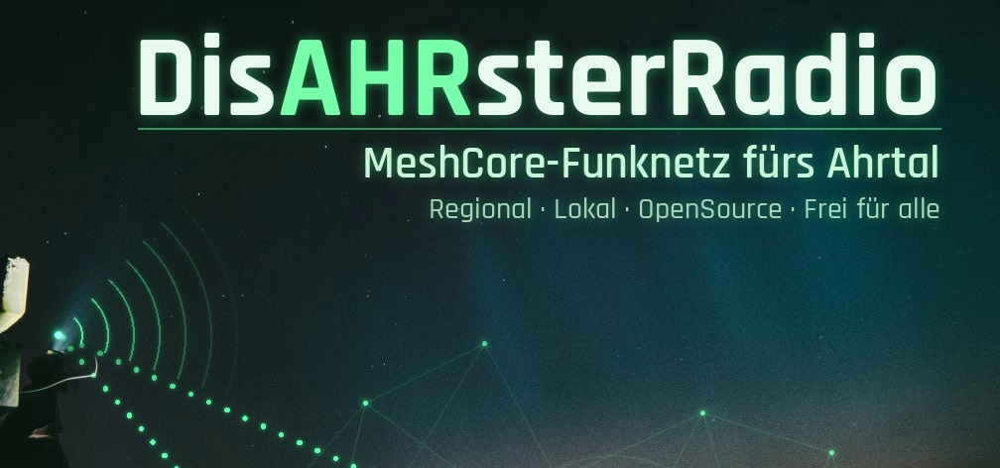
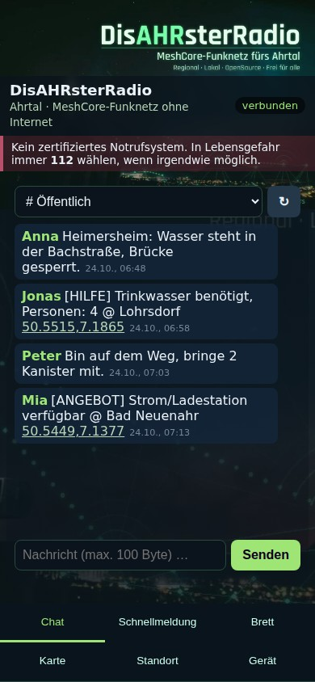
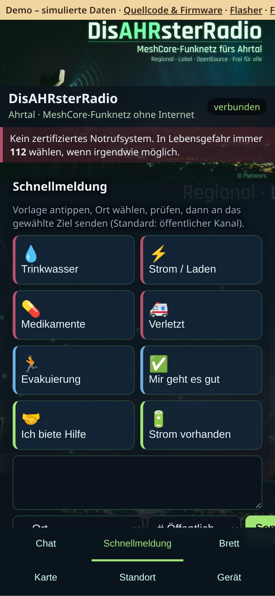
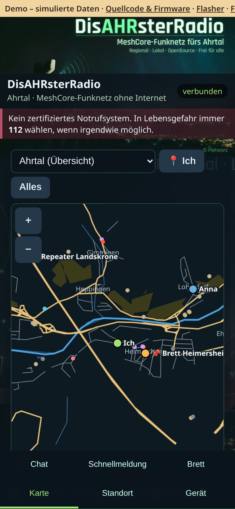
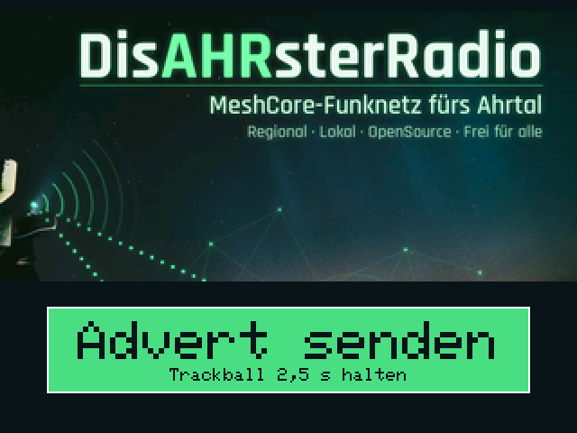
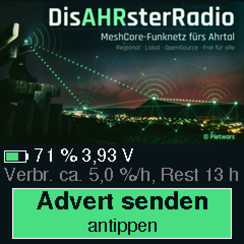

# DisAHRsterRadio-MeshCore

**DisAHRsterRadio mit MeshCore fürs Ahrtal: Weboberfläche MeshAhrtal im offenen WLAN und gleichzeitig die offizielle MeshCore-App per Bluetooth – Chat, Brett und Offlinekarten ohne Internet.**

Aufnahmen der [Live-Demo](https://pietwars.github.io/DisAHRsterRadio-MeshCore/) in Handygröße, Stand 0.9.2; alle Daten simuliert.

**Version 0.9.2** · MeshCore 1.18.0 · Weboberfläche MeshAhrtal · 868 MHz · Firmwarekennung `v1.18.0-dar0.9.2`

**Release v0.9.2** vom 18.10.2026 – auf echter Hardware getestet (LILYGO T-Deck Plus und LILYGO T-Watch S3).

Flyer (A5): [Druck-PDF mit QR-Codes](docs/flyer/DisAHRsterRadio-MeshCore-Flyer.pdf) · [Digital-PDF mit Links](docs/flyer/DisAHRsterRadio-MeshCore-Flyer-digital.pdf) · [Vorschau](docs/flyer/DisAHRsterRadio-MeshCore-Flyer-vorschau.jpg)

## Was kann es

- **Chat:** öffentlicher Kanal, eigene Kanäle und Direktnachrichten über MeshCore, Verlauf auf dem Board
- **Schnellmeldungen:** Trinkwasser, Strom, Medikamente, Verletzt, Evakuierung – mit Ortsangabe
- **Schwarzes Brett:** MeshCore-Room-Server, Beitritt automatisch mit dem öffentlichen Gast-Passwort `hello`
- **Karte und Standort:** Offlinekarten des Ahrtals direkt aus der Firmware, Knoten und geteilte Positionen; Handy-GPS oder Ortsliste
- **WLAN + Bluetooth gleichzeitig:** Weboberfläche im Browser und parallel die MeshCore-App mit vollem Funktionsumfang (PIN-Kopplung)
- **Gerät:** Status, Kontakte, Knotenname, feste Deutschland-Funkprofile, Kanäle – ohne Anmeldung

Nachrichten, Kontakte und Einstellungen laufen **nur über die Weboberfläche und die MeshCore-App** – nicht am Gerät selbst.

## Unterstützte Geräte

| Board | Paket (Release v0.9.2) |
|---|---|
| **LILYGO T-Deck Plus** (ESP32-S3, SX1262, 868 MHz) | `DisAHRsterRadio-MeshCore-0.9.2-LilyGo_TDeck.zip` |
| **LILYGO T-Watch S3** (ESP32-S3, SX1262, 868 MHz) | `DisAHRsterRadio-MeshCore-0.9.2-LilyGo_TWatchS3.zip` |

Jedes Paket enthält `…-factory.bin` (komplett an **0x0**), `…-firmware.bin` (Update an **0x10000**), die Einzelteile, `SHA256SUMS` und eine deutsche `ANLEITUNG.md`.

## Anzeige am Gerät

 

Simulation der Anzeige (links T-Deck Plus, rechts T-Watch S3).

Das Display zeigt nur zwei Dinge:

- **Bild:** das Ahrtal bei Nacht – Lichter der Orte im Tal, ein Berg vor rötlichem Himmel, links eine Person auf einem Holzgerüst mit leuchtendem Funkgerät, darüber eingezeichnete Funkwellen und Mesh-Verbindungen; oben rechts der Schriftzug **DisAHRsterRadio** mit „MeshCore-Funknetz fürs Ahrtal“ (T-Deck 320×180, T-Watch 240×140 Pixel).
- **Knopf „Advert senden“** darunter, mit Hinweis „Trackball 2,5 s halten“ (T-Deck, Pixelschrift) bzw. „antippen“ (T-Watch, glatte Schrift FreeSans).

Jeder Advert ist ein **Flood-Advert**; danach steht kurz „Advert gesendet“ im Knopf. Höchstens ein Advert je 10 s (sonst „Bitte N s warten“). Das Display geht nach 30 s ohne Bedienung aus. Die **Bluetooth-PIN** erscheint nur während einer laufenden Kopplung (höchstens 60 s).

**LILYGO T-Deck Plus**

| Bedienung | Wirkung |
|---|---|
| Trackball kurz klicken | Display an/aus |
| Trackball 2,5 s gedrückt halten | Flood-Advert senden |
| Tastatur (auch Enter) | keine Funktion |
| Ein/Aus | Schiebeschalter (kein Ausschalten per Trackball) |

**LILYGO T-Watch S3**

| Bedienung | Wirkung |
|---|---|
| Seitentaste kurz | Display an/aus (bei ausgeschalteter Uhr: einschalten) |
| Seitentaste ca. 2 s halten | Flood-Advert senden |
| Seitentaste ca. 6 s halten | Uhr ausschalten (Power-Chip) |
| Knopf „Advert senden“ antippen | Flood-Advert senden |
| Antippen bei dunklem Display | nur aufwecken |

## Schnellstart

1. **Flashen:** am einfachsten mit dem [Web-Flasher](https://pietwars.github.io/DisAHRsterRadio-MeshCore/flasher/) (Chrome/Edge am Computer). Grüner Knopf **„Update auf 0.9.2 – … (Einstellungen bleiben)“** (empfohlen, schreibt nur `…-firmware.bin` an 0x10000) oder orange umrandeter Knopf **„Neuinstallation – … (alles löschen)“** (`…-factory.bin` an 0x0, löscht Identität, Kontakte und Verlauf). Ohne Web-Flasher: [Anleitung Flashen](docs/FLASHEN.md) (esptool).
2. **Verbinden:** Handy mit dem offenen WLAN `DisAHRsterRadio-XXXXXX` verbinden, **http://192.168.4.1** öffnen – kein Passwort, höchstens 4 Handys.
3. **MeshCore-App (optional):** per Bluetooth koppeln; die PIN zeigt das Display nur während der Kopplung an. Danach in der App eine eigene PIN setzen. Details: [Offener Zugang](docs/OFFENER_ZUGANG.md)

## Funk

MeshCore-Preset **EU/UK (Narrow): 869,618 MHz**, 62,5 kHz, SF8, CR 4/8 (SRD-Teilband 869,4–869,65 MHz, 10 % Sendezeit). Alle Knoten eines Netzes brauchen dasselbe Profil. Funkt mit anderen MeshCore-Geräten, nicht mit LoRaLayer2 oder Meshtastic.

<!-- projektfamilie:start -->
## Projektfamilie DisAHRsterRadio / HaldenFunk

| Repository | Inhalt | Funk | Version | Demo · Download · Flyer |
|---|---|---|---|---|
| [Pietwars/DisAHRsterRadio-MeshCore](https://github.com/Pietwars/DisAHRsterRadio-MeshCore) | MeshCore 1.18 mit kompakter MeshAhrtal-Oberfläche per WLAN plus Bluetooth für die MeshCore-App; Firmware für LILYGO T-Deck Plus und T-Watch S3 (Ahrtal) | MeshCore | 0.9.2 | [Live-Demo](https://pietwars.github.io/DisAHRsterRadio-MeshCore/) · [Releases](https://github.com/Pietwars/DisAHRsterRadio-MeshCore/releases) · Flyer [Druck](https://pietwars.github.io/DisAHRsterRadio-MeshCore/flyer/DisAHRsterRadio-MeshCore-Flyer.pdf) / [digital](https://pietwars.github.io/DisAHRsterRadio-MeshCore/flyer/DisAHRsterRadio-MeshCore-Flyer-digital.pdf) |
| [Pietwars/DisAHRsterRadio](https://github.com/Pietwars/DisAHRsterRadio) | Ohne MeshCore: modernisiertes disaster-radio (LoRaLayer2, RadioLib) mit kompakter MeshAhrtal-Oberfläche (Ahrtal) | LoRaLayer2 | 0.9.1 | [Live-Demo](https://pietwars.github.io/DisAHRsterRadio/) · [Release v0.9.1](https://github.com/Pietwars/DisAHRsterRadio/releases/tag/v0.9.1) · Flyer [Druck](https://pietwars.github.io/DisAHRsterRadio/flyer/DisAHRsterRadio-Flyer.pdf) / [digital](https://pietwars.github.io/DisAHRsterRadio/flyer/DisAHRsterRadio-Flyer-digital.pdf) |
| [Pietwars/HaldenFunk](https://github.com/Pietwars/HaldenFunk) | Regionalvariante von DisAHRsterRadio für Sangerhausen / Mansfelder Land, ohne MeshCore | LoRaLayer2 | 0.9.1 | [Live-Demo](https://pietwars.github.io/HaldenFunk/) · [Release v0.9.1](https://github.com/Pietwars/HaldenFunk/releases/tag/v0.9.1) · Flyer [Druck](https://pietwars.github.io/HaldenFunk/flyer/HaldenFunk-Flyer.pdf) / [digital](https://pietwars.github.io/HaldenFunk/flyer/HaldenFunk-Flyer-digital.pdf) |
| [Pietwars/HaldenFunk-MeshCore](https://github.com/Pietwars/HaldenFunk-MeshCore) | Regionalvariante von DisAHRsterRadio-MeshCore für das Mansfelder Land: MeshCore 1.18, WLAN + Bluetooth, Gerätematrix | MeshCore | 0.9.1 | [Live-Demo](https://pietwars.github.io/HaldenFunk-MeshCore/) · [Release v0.9.1](https://github.com/Pietwars/HaldenFunk-MeshCore/releases/tag/v0.9.1) · Flyer [Druck](https://pietwars.github.io/HaldenFunk-MeshCore/flyer/HaldenFunk-MeshCore-Flyer.pdf) / [digital](https://pietwars.github.io/HaldenFunk-MeshCore/flyer/HaldenFunk-MeshCore-Flyer-digital.pdf) |

Gleiche Spalte **Funk** = Geräte können miteinander funken (gleiches Funkprofil vorausgesetzt). MeshCore- und LoRaLayer2-Varianten verstehen sich **nicht**.

**Namen:** **DisAHRsterRadio** = Projekt und Marke (WLAN `DisAHRsterRadio-XXXXXX`) · **MeshAhrtal** = die Weboberfläche im Handy-Browser · **HaldenFunk – Glück Auf** = Regionalvariante fürs Mansfelder Land (WLAN `HaldenFunk-XXXXXX`).

Alle Demos sind simuliert.
<!-- projektfamilie:end -->

## Sicherheit

> ⚠️ Prototyp, **kein zertifiziertes Notrufsystem**. Im Notfall immer **112** wählen. Im offenen WLAN kann jede Person mitlesen und senden sowie Kanäle, Knotenname und Funkprofil ändern.

## Mehr Doku

[Details (ausführlich)](docs/DETAILS.md) · [Anleitung Flashen](docs/FLASHEN.md) · [Offener Zugang](docs/OFFENER_ZUGANG.md) · [Änderungen](CHANGELOG.md) · [Original-README MeshCore](README.meshcore.md)

## Lizenz

[MeshCore](https://github.com/meshcore-dev/MeshCore) © Scott Powell / rippleradios.com und Mitwirkende, MIT (`license.txt`). WLAN-Portal und Weboberfläche von Pietwars, hier unter MIT; Weboberfläche aus [DisAHRsterRadio](https://github.com/Pietwars/DisAHRsterRadio). Kartendaten © OpenStreetMap-Mitwirkende, ODbL 1.0.
