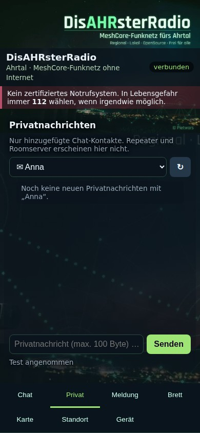

# DisAHRsterRadio-MeshCore

## 0.9.10: Geräteübersicht auf einen Blick

Im Web-Reiter **Gerät** stehen jetzt **Gerätename, WLAN-Name, Bluetooth-Verbindung
und aktuelles Funkprofil** gemeinsam oben. Frequenz, Bandbreite, SF, Coding Rate
und Sendeleistung entsprechen den aktuellen Einstellungen der MeshCore-App.
Eigene Einstellungen werden als **Eigenes Profil** angezeigt. Weitere
Gerätedaten lassen sich bei Bedarf aufklappen. Das OLED unterscheidet Bluetooth
bereit, verbunden und aus.

**Gerätetest 0.9.9 bestätigt:** Zwei Boards, parallele Web-/App-Nutzung,
Nachrichten und Neustarts ohne beobachtete Abbrüche. Die neue Version 0.9.10
benötigt ihren eigenen Gerätetest.

[Release v0.9.10](https://github.com/Pietwars/DisAHRsterRadio-MeshCore/releases/tag/v0.9.10) ·
[Hardwarestatus und Bedienung](docs/RELEASE-0.9.10.md)

## Seit 0.9.9: Jedes Board bekommt seinen eigenen WLAN-Namen

Mehrere Boards desselben Herstellers konnten bisher denselben WLAN-Namen
bekommen. Das ist korrigiert: Die vollständige Hardwarekennung unterscheidet
jetzt jedes Board, zum Beispiel `DisAHRsterRadio-246F28123456` und
`DisAHRsterRadio-246F28123457`. Der Name bleibt bei Neustart und erneutem
Flashen gleich. Das OLED zeigt ihn vollständig auf zwei Zeilen; im Web-Reiter
**Gerät** steht er ebenfalls. Nach dem Firmware-Update am Handy das neue WLAN
wählen. Ein Update ohne Löschen erhält die bisherigen Gerätedaten und PINs.

[Release v0.9.9](https://github.com/Pietwars/DisAHRsterRadio-MeshCore/releases/tag/v0.9.9) ·
[Änderungen und Hardwarestatus](docs/RELEASE-0.9.9.md)

## Seit 0.9.8: T3-S3 v1.3 mit Weboberfläche und Bluetooth-PIN am OLED

**Neu als reguläres Release-Gerät: LILYGO T3-S3 v1.3 mit SX1262 für 868 MHz.**
Weboberfläche im WLAN und MeshCore-App per Bluetooth funktionieren gleichzeitig.
Beim Koppeln wacht das OLED automatisch auf und zeigt die sechsstellige Geräte-PIN
groß an. Nach Kopplungsende, Abbruch oder spätestens 60 Sekunden verschwindet sie.
Die Startseite zeigt WLAN-Name, Browseradresse und Nachrichtenanzahl.

Im Web-Reiter **Gerät** stehen jetzt Bluetooth-Status und Kopplungsanleitung.
Die PIN selbst bleibt am Gerät. Der Betreiber hat die Funktion des zuvor
bereitgestellten OLED-Testpakets am 30.10.2026 bestätigt; diese Rückmeldung
ersetzt keine vollständige Abnahme der neu gebauten Release-Dateien.

[Release v0.9.8](https://github.com/Pietwars/DisAHRsterRadio-MeshCore/releases/tag/v0.9.8) ·
[T3-S3-Anleitung](docs/T3-S3-V1.3.md) · [Hardwarestatus](docs/RELEASE-0.9.8.md) ·
[Live-Demo und Oberfläche](https://pietwars.github.io/DisAHRsterRadio-MeshCore/) ·
[Web-Flasher](https://pietwars.github.io/DisAHRsterRadio-MeshCore/flasher/)

Frühere Versionen: Optimierungen und Standalone-Einführung

## Bisheriger Stand: 0.9.7-cleanup-opt – Optimization & Cleanup Pass

**Optimized Standalone for T-Deck Plus with all TODO resolutions and performance improvements.**

- Smaller buffers (`OFFLINE_QUEUE_SIZE=32`) and ignored unused sensor libraries → reduced RAM/Flash.
- Power-Management: CPU frequency scaling (80 MHz when display off, 240 MHz on wake) for better battery life.
- UI-Redraws and dirty flags optimized, LTO fixes, -Os compiler flag, debug output disabled.
- All TODOs from the 5-batch cleanup pass resolved (zero-init, UTF-8, cache eviction, bkg-handling, entropy, guards, structured comments).
- RAM: 43.4 % (142 kB), Flash: 55.6 % (1.75 MB).
- Firmwarekennung `v1.18.0-dar0.9.7-cleanup-opt`.

[Release v0.9.7-cleanup-opt](https://github.com/Pietwars/DisAHRsterRadio-MeshCore/releases/tag/v0.9.7-cleanup-opt) · [Live-Demo](https://pietwars.github.io/DisAHRsterRadio-MeshCore/) · Updated docs in `docs/` and `RELEASE.md`.

## 0.9.6: T-Deck direkt bedienen

**Öffentlicher Release 0.9.6.** Standalone für T-Deck Plus mit eigenem Tab **Privat** für gespeicherte Kontakte; **Chat** zeigt Kanäle. Der private Verlauf startet bei der ersten Nutzung dieser Version leer, gespeicherte Kontakte bleiben erhalten. WLAN/BLE für T-Deck Plus und T-Watch S3 sind getrennte Pakete und bieten ebenfalls einen eigenen Privatbereich mit aktuellen gespeicherten Chat-Kontakten. **Geräterückmeldung:** Privatversand sowie SD-Erkennung und Laden wurden am T-Deck Plus vom Betreiber bestätigt. Die angeglichene WLAN/BLE-Version benötigt weiterhin eigene Gerätetests; automatisierte Tests ersetzen keine vollständige Hardwareabnahme.

Privilegierte Web-Einstellungen sind im offenen HTTP-Portal gesperrt. Standalone-Einstellungen erfolgen lokal bzw. über die authentifizierte MeshCore-App. Standalone verwendet die ursprüngliche MeshCore-Sendepolitik; auch WLAN/BLE verwendet jetzt denselben MeshCore-Sendeweg. Eine vollständige SOS-Funktion ist nicht enthalten. [Stand und Grenzen](docs/RELEASE-0.9.6.md).

Echte 320 × 240 Layouts aus dem Firmware-Code mit Demodaten. Keine Hardwarefotos. [Alle neuen Vorschauen](docs/STANDALONE_VORSCHAU.md).

- **Touch:** große getrennte Flächen, wischbare Listen, feste Zurück-Navigation und verschiebbare Karte.
- **Senden:** eigener Button; Wischen oder Wegziehen löst keine Nachricht aus. Tastatur und Trackball bleiben vollständig nutzbar.
- **Touch-Kalibrierung:** dauerhaft gespeichert und unter Gerät wiederholbar.
- **GPS-Schutz:** Heimersheim Mitte ohne Fix ist nur Kartenansicht, niemals gesendete Eigenposition.
- **Varianten:** Standalone für T-Deck Plus ohne WLAN/Web, mit MeshCore-Bluetooth. Der bisherige WLAN/BLE-Betrieb und die T-Watch S3 bleiben getrennte Varianten.

[Touch-Bedienung](docs/STANDALONE_TOUCH.md) · [0.9.6-Release und Hardwarestatus](docs/RELEASE-0.9.6.md) · [Release und Downloads](https://github.com/Pietwars/DisAHRsterRadio-MeshCore/releases/tag/v0.9.6)

## WLAN und Bluetooth in 0.9.10

**DisAHRsterRadio mit MeshCore fürs Ahrtal: Weboberfläche MeshAhrtal im offenen WLAN und gleichzeitig die offizielle MeshCore-App per Bluetooth – Chat, Brett und Offlinekarten ohne Internet.**

Aufnahmen der [Live-Demo](https://pietwars.github.io/DisAHRsterRadio-MeshCore/) in Handygröße, Stand 0.9.10; alle Daten simuliert.

**Version 0.9.10** · MeshCore 1.18.0 · Weboberfläche MeshAhrtal · 868 MHz · Firmwarekennung `v1.18.0-dar0.9.10`

**Weiterhin enthalten:** Akku-Anzeige am Gerät und automatische Flash-/Speicherprüfungen für alle drei WLAN/BLE-Release-Boards. Messwerte und offene Hardwaretests: [Flash- und RAM-Prüfung](docs/SPEICHER.md).

**[Release v0.9.9](https://github.com/Pietwars/DisAHRsterRadio-MeshCore/releases/tag/v0.9.9)** vom 30.10.2026. Jedes Board erhält automatisch seinen eigenen stabilen WLAN-Namen. Das T3-S3-v1.3-Paket für SX1262 enthält die automatische OLED-Kopplungsanzeige. Nachrichten werden zwischen Weboberfläche und MeshCore-App geteilt. Der Standalone-Build bedient Chat, Privat, Meldung, Brett, Karte, Standort und Gerät direkt am T-Deck; er enthält kein WLAN/Webportal. [Hardwarestatus und Prüfungen](docs/RELEASE-0.9.9.md).

Flyer (A5): [Druck-PDF mit QR-Codes](docs/flyer/DisAHRsterRadio-MeshCore-Flyer.pdf) · [Digital-PDF mit Links](docs/flyer/DisAHRsterRadio-MeshCore-Flyer-digital.pdf) · [Vorschau](docs/flyer/DisAHRsterRadio-MeshCore-Flyer-vorschau.jpg)

## Was kann es

- **Chat:** öffentlicher Kanal und eigene Kanäle über MeshCore, Verlauf auf dem Board
- **Privat:** eigener Bereich für hinzugefügte Chat-Kontakte, ohne Repeater und Roomserver; aktuelle Kontakte auch jenseits der früheren 64er-Grenze
- **Schnellmeldungen:** Trinkwasser, Strom, Medikamente, Verletzt, Evakuierung – mit Ortsangabe
- **Schwarzes Brett:** MeshCore-Room-Server, Beitritt automatisch mit dem öffentlichen Gast-Passwort `hello`
- **Karte und Standort:** Offlinekarten des Ahrtals direkt aus der Firmware, Knoten und geteilte Positionen; Handy-GPS oder Ortsliste
- **WLAN + Bluetooth gleichzeitig:** Weboberfläche im Browser und parallel die MeshCore-App mit vollem Funktionsumfang (PIN-Kopplung)
- **Gerät:** Status und Kontakte ohne Anmeldung; geschützte Einstellungen lokal bzw. über die MeshCore-App
- **Akku am Display:** Ladestand und Spannung; T-Watch zusätzlich USB-/Ladestatus. Verbrauch und Restlaufzeit sind gekennzeichnete Schätzungen.

Im **WLAN/BLE-Build** laufen Nachrichten, Kontakte und Einstellungen über Weboberfläche und MeshCore-App. Die **Standalone-Variante für T-Deck Plus** bietet lokale Bedienung und MeshCore-Bluetooth, ohne WLAN/Webportal.

## Unterstützte Geräte

| Board | Paket (Release v0.9.10) |
|---|---|
| **LILYGO T3-S3 v1.3** (ESP32-S3, SX1262, 868 MHz, OLED) | [DisAHRsterRadio-MeshCore-0.9.10-LilyGo_T3S3_sx1262.zip](https://github.com/Pietwars/DisAHRsterRadio-MeshCore/releases/download/v0.9.10/DisAHRsterRadio-MeshCore-0.9.10-LilyGo_T3S3_sx1262.zip) |
| **LILYGO T-Deck Plus** (ESP32-S3, SX1262, 868 MHz) | [DisAHRsterRadio-MeshCore-0.9.10-LilyGo_TDeck.zip](https://github.com/Pietwars/DisAHRsterRadio-MeshCore/releases/download/v0.9.10/DisAHRsterRadio-MeshCore-0.9.10-LilyGo_TDeck.zip) |
| **LILYGO T-Watch S3** (ESP32-S3, SX1262, 868 MHz) | [DisAHRsterRadio-MeshCore-0.9.10-LilyGo_TWatchS3.zip](https://github.com/Pietwars/DisAHRsterRadio-MeshCore/releases/download/v0.9.10/DisAHRsterRadio-MeshCore-0.9.10-LilyGo_TWatchS3.zip) |

**T-Deck Plus Standalone (ohne WLAN/Web):** [DisAHRsterRadio-MeshCore-0.9.10-LilyGo_TDeck_standalone-test6.zip](https://github.com/Pietwars/DisAHRsterRadio-MeshCore/releases/download/v0.9.10/DisAHRsterRadio-MeshCore-0.9.10-LilyGo_TDeck_standalone-test6.zip). Firmwarekennung `v1.18.0-dar0.9.10-standalone-test6`; eigene Bedienung, Anleitung, Commitmanifest und Vorschauen im ZIP. Die Hardwareabnahme für 0.9.10 ist offen; frühere Testergebnisse gelten nicht als Nachweis für diese Dateien.

Die drei WLAN/BLE-Pakete enthalten `…-factory.bin` (komplett an **0x0**), `…-firmware.bin` (Update an **0x10000**), die Einzelteile, `SHA256SUMS`, Flash-/RAM-Berichte und eine deutsche `ANLEITUNG.md`.

## Anzeige am Gerät im WLAN/BLE-Build

 

Gerätedisplays in 0.9.4 mit Akku-Zeile: links T-Deck Plus, rechts T-Watch S3. Simulation mit Beispielwerten. Die Handy-Bilder oben zeigen die Weboberfläche.

Das Display zeigt:

- **Bild:** das Ahrtal bei Nacht – Lichter der Orte im Tal, ein Berg vor rötlichem Himmel, links eine Person auf einem Holzgerüst mit leuchtendem Funkgerät, darüber eingezeichnete Funkwellen und Mesh-Verbindungen; oben rechts der Schriftzug **DisAHRsterRadio** mit „MeshCore-Funknetz fürs Ahrtal“ (T-Deck 320×180, T-Watch 240×140 Pixel).
- **Akku-Zeile:** Symbol, Ladestand und Spannung. T-Deck: „ca. NN %“ aus der Spannung; T-Watch: Ladestand vom AXP2101 plus USB-/Ladestatus. Verbrauch in %/h und Restlaufzeit sind Schätzungen aus mindestens 20 Minuten Spannungsverlauf; keines der Boards misst Akkustrom. [Details](docs/DETAILS.md#akku-zeile-ab-094).
- **Knopf „Advert senden“** darunter, mit Hinweis „Trackball 2,5 s halten“ (T-Deck, Pixelschrift) bzw. „antippen“ (T-Watch, glatte Schrift FreeSans).

Jeder Advert ist ein **Flood-Advert**; danach steht kurz „Advert gesendet“ im Knopf. Höchstens ein Advert je 10 s (sonst „Bitte N s warten“). Das Display geht nach 30 s ohne Bedienung aus. Die **Bluetooth-PIN** erscheint nur während einer laufenden Kopplung (höchstens 60 s).

**LILYGO T-Deck Plus**

| Bedienung | Wirkung |
|---|---|
| Trackball kurz klicken | Display an/aus |
| Trackball 2,5 s gedrückt halten | Flood-Advert senden |
| Tastatur (auch Enter) | keine Funktion |
| Ein/Aus | Schiebeschalter (kein Ausschalten per Trackball) |

**LILYGO T-Watch S3**

| Bedienung | Wirkung |
|---|---|
| Seitentaste kurz | Display an/aus (bei ausgeschalteter Uhr: einschalten) |
| Seitentaste ca. 2 s halten | Flood-Advert senden |
| Seitentaste ca. 6 s halten | Uhr ausschalten (Power-Chip) |
| Knopf „Advert senden“ antippen | Flood-Advert senden |
| Antippen bei dunklem Display | nur aufwecken |

## Schnellstart: WLAN/BLE

**LILYGO T3-S3 v1.3 mit SX1262 (868 MHz):** Das Profil
`disaster_t3s3_sx1262_wifi` bietet Weboberfläche und Bluetooth gleichzeitig.
Beim Koppeln mit der MeshCore-App wacht das OLED automatisch auf und zeigt
die Geräte-PIN. [T3-S3-Anleitung und Hardwareprüfung](docs/T3-S3-V1.3.md).

1. **Flashen:** das passende 0.9.10-ZIP oben herunterladen und nach seiner ANLEITUNG.md flashen. Der [Web-Flasher](https://pietwars.github.io/DisAHRsterRadio-MeshCore/flasher/) bietet nach erfolgreicher Veröffentlichung dieselben geprüften Release-Dateien für **T-Deck Plus WLAN/BLE**, **T-Deck Plus Standalone** und **T-Watch S3**. Variante ausdrücklich auswählen: Update schreibt nur die Firmware an **0x10000**, Neuinstallation schreibt das Factory-Abbild an **0x0** und löscht alle Daten. [Anleitung Flashen](docs/FLASHEN.md).
2. **Verbinden:** Handy mit dem offenen WLAN `DisAHRsterRadio-XXXXXXXXXXXX` verbinden, **http://192.168.4.1** öffnen – kein Passwort, höchstens 4 Handys.
3. **MeshCore-App (optional):** per Bluetooth koppeln; die PIN zeigt das Display nur während der Kopplung an. Danach in der App eine eigene PIN setzen. Details: [Offener Zugang](docs/OFFENER_ZUGANG.md)

## Funk

MeshCore-Preset **EU/UK (Narrow): 869,618 MHz**, 62,5 kHz, SF8, CR 4/8 (SRD-Teilband 869,4–869,65 MHz, 10 % Sendezeit). Alle Knoten eines Netzes brauchen dasselbe Profil. Funkt mit anderen MeshCore-Geräten, nicht mit LoRaLayer2 oder Meshtastic.

<!-- projektfamilie:start (in allen vier Repositorys identisch) -->
## Projektfamilie DisAHRsterRadio / HaldenFunk

| Repository | Inhalt | Funk | Version | Demo · Download · Flyer |
|---|---|---|---|---|
| [Pietwars/DisAHRsterRadio-MeshCore](https://github.com/Pietwars/DisAHRsterRadio-MeshCore) | MeshCore 1.18 mit kompakter MeshAhrtal-Oberfläche per WLAN plus Bluetooth für die MeshCore-App; Firmware für LILYGO T-Deck Plus und T-Watch S3 (Ahrtal) | MeshCore | 0.9.10 | [Live-Demo](https://pietwars.github.io/DisAHRsterRadio-MeshCore/) · [Release v0.9.6](https://github.com/Pietwars/DisAHRsterRadio-MeshCore/releases/tag/v0.9.6) · Flyer [Druck](https://pietwars.github.io/DisAHRsterRadio-MeshCore/flyer/DisAHRsterRadio-MeshCore-Flyer.pdf) / [digital](https://pietwars.github.io/DisAHRsterRadio-MeshCore/flyer/DisAHRsterRadio-MeshCore-Flyer-digital.pdf) |
| [Pietwars/DisAHRsterRadio](https://github.com/Pietwars/DisAHRsterRadio) | Ohne MeshCore: modernisiertes disaster-radio (LoRaLayer2, RadioLib) mit kompakter MeshAhrtal-Oberfläche; Firmware für LILYGO T-Deck Plus und T-Watch S3 (Ahrtal) | LoRaLayer2 | 0.9.2 | [Live-Demo](https://pietwars.github.io/DisAHRsterRadio/) · [Release v0.9.2](https://github.com/Pietwars/DisAHRsterRadio/releases/tag/v0.9.2) · Flyer [Druck](https://pietwars.github.io/DisAHRsterRadio/flyer/DisAHRsterRadio-Flyer.pdf) / [digital](https://pietwars.github.io/DisAHRsterRadio/flyer/DisAHRsterRadio-Flyer-digital.pdf) |
| [Pietwars/HaldenFunk](https://github.com/Pietwars/HaldenFunk) | Regionalvariante von DisAHRsterRadio für Sangerhausen / Mansfelder Land, ohne MeshCore; Firmware für LILYGO T-Deck Plus und T-Watch S3 | LoRaLayer2 | 0.9.2 | [Live-Demo](https://pietwars.github.io/HaldenFunk/) · [Release v0.9.2](https://github.com/Pietwars/HaldenFunk/releases/tag/v0.9.2) · Flyer [Druck](https://pietwars.github.io/HaldenFunk/flyer/HaldenFunk-Flyer.pdf) / [digital](https://pietwars.github.io/HaldenFunk/flyer/HaldenFunk-Flyer-digital.pdf) |
| [Pietwars/HaldenFunk-MeshCore](https://github.com/Pietwars/HaldenFunk-MeshCore) | Regionalvariante von DisAHRsterRadio-MeshCore für das Mansfelder Land: MeshCore 1.18, WLAN + Bluetooth; Firmware für LILYGO T-Deck Plus und T-Watch S3 | MeshCore | 0.9.2 | [Live-Demo](https://pietwars.github.io/HaldenFunk-MeshCore/) · [Release v0.9.2](https://github.com/Pietwars/HaldenFunk-MeshCore/releases/tag/v0.9.2) · Flyer [Druck](https://pietwars.github.io/HaldenFunk-MeshCore/flyer/HaldenFunk-MeshCore-Flyer.pdf) / [digital](https://pietwars.github.io/HaldenFunk-MeshCore/flyer/HaldenFunk-MeshCore-Flyer-digital.pdf) |

Diese vier Repositorys sind die aktive Projektfamilie. [Pietwars/DisasterMesh](https://github.com/Pietwars/DisasterMesh) ist **archiviert** und gehört nicht mehr dazu.

Gleiche Spalte **Funk** = Geräte können miteinander funken (gleiches Funkprofil vorausgesetzt). MeshCore- und LoRaLayer2-Varianten verstehen sich **nicht**.

**Namen:** **DisAHRsterRadio** = Projekt und Marke (WLAN `DisAHRsterRadio-XXXXXXXXXXXX`) · **MeshAhrtal** = die Weboberfläche im Handy-Browser · **HaldenFunk – Glück Auf** = Regionalvariante fürs Mansfelder Land (WLAN `HaldenFunk-XXXXXX`).

Alle Demos sind simuliert.
<!-- projektfamilie:end -->

## Sicherheit

> ⚠️ Prototyp, **kein zertifiziertes Notrufsystem**. Im Notfall immer **112** wählen. Im offenen WLAN kann jede Person mitlesen und senden. Privilegierte Web-Änderungen an Kanälen, Knotenname und Funkprofil sind in 0.9.6 gesperrt.

## Mehr Doku

[Details (ausführlich)](docs/DETAILS.md) · [Anleitung Flashen](docs/FLASHEN.md) · [Flash- und RAM-Prüfung](docs/SPEICHER.md) · [Offener Zugang](docs/OFFENER_ZUGANG.md) · [Änderungen](CHANGELOG.md) · [Original-README MeshCore](README.meshcore.md)

## Schnellstart: T-Deck Plus Standalone

1. Antenne anschrauben, Identität/Kontakte/Einstellungen sichern und das ausdrücklich als **Standalone** bezeichnete ZIP oben herunterladen. SHA-256 mit `SHA256SUMS` prüfen; die äußere ZIP-Prüfsumme steht im Release.
2. Bei passender bestehender MeshCore-Installation `firmware.bin` an **0x10000** aktualisieren, **ohne Löschen**. Bei Wechsel von anderer Firmware oder unbekannten Partitionen: `factory.bin` an **0x0**, vorher Flash vollständig löschen; dabei gehen Identität, Kontakte, Verlauf und Einstellungen verloren. Nicht die WLAN- und Standalone-Pakete verwechseln.
3. Beim ersten Start die angezeigten Touch-Ziele kalibrieren. Die Kalibrierung bleibt nach Neustart erhalten und ist unter **Gerät → Touch kalibrieren** wiederholbar.
4. Chat, Meldung, Brett, Karte, Standort oder Gerät per Kachel öffnen. Listen wischen, Karte ziehen, mit Zurück eine Ebene hoch. Tastatur und Trackball bleiben nutzbar. Eine Nachricht wird über die ausdrücklich beschriftete Sendeaktion verschickt.
5. Für GPS-Übertragung **Standort teilen** bewusst einschalten und einen frischen Fix abwarten. Heimersheim ohne Fix ist nur die Kartenansicht, keine eigene Position. MeshCore-App bei Bedarf über Bluetooth koppeln; die PIN erscheint während der Kopplung.

[Touch-Bedienung](docs/STANDALONE_TOUCH.md) · [Alle Geräte-Vorschauen](docs/STANDALONE_VORSCHAU.md) · [Release-/Hardwarestatus](docs/RELEASE-0.9.6.md). Die frühere [standalone-test5](https://github.com/Pietwars/DisAHRsterRadio-MeshCore/releases/tag/standalone-test5) bleibt historische Testversion.

## Lizenz

[MeshCore](https://github.com/meshcore-dev/MeshCore) © Scott Powell / rippleradios.com und Mitwirkende, MIT (`license.txt`). WLAN-Portal und Weboberfläche von Pietwars, hier unter MIT; Weboberfläche aus [DisAHRsterRadio](https://github.com/Pietwars/DisAHRsterRadio). Kartendaten © OpenStreetMap-Mitwirkende, ODbL 1.0.

## Nächstes Projekt

[Pegel Heimersheim: Heltec-V2-Sensor-Node mit HC-SR04](https://github.com/Pietwars/DisAHRsterRadio-MeshCore/issues/51) ist als nächstes Vorhaben mit vollständigem Auftrag vorgemerkt. Noch keine Implementierung oder Hardwarefreigabe.
