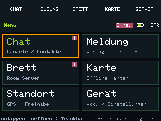
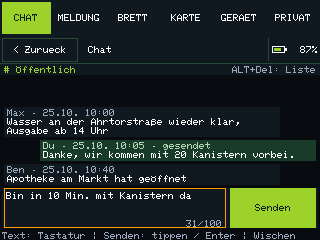
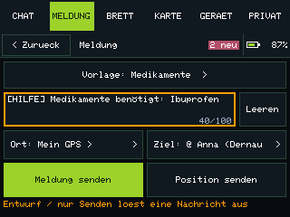
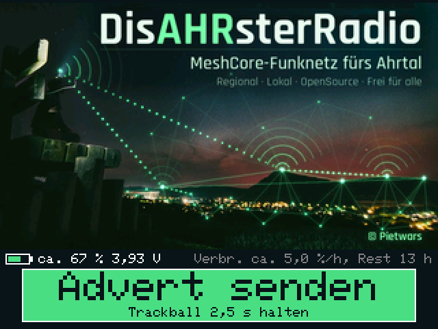

# DisAHRsterRadio-MeshCore

## 0.9.5: T-Deck direkt bedienen

**Release 0.9.5 · 21.10.2026.** T-Deck Plus bekommt eine eigene Standalone-Variante mit vollständiger Touch-Bedienung. WLAN/BLE für T-Deck Plus und T-Watch S3 bleiben getrennte Pakete. **Am 21.10.2026 vom Nutzer am T-Deck erfolgreich getestet:** „test klappt“. Das bestätigt den Standalone-Teststand mit neuer Touch-Oberfläche. Eine vollständige Hardwareabnahme mit Einzelprüfung aller Funktionen sowie die Zuordnung zum konkret geflashten CI-Commit/SHA wurden nicht dokumentiert.

Echte 320 × 240 Layouts aus dem Firmware-Code mit Demodaten. Keine Hardwarefotos. [Alle neuen Vorschauen](docs/STANDALONE_VORSCHAU.md).

- **Touch:** große getrennte Flächen, wischbare Listen, feste Zurück-Navigation und verschiebbare Karte.
- **Senden:** eigener Button; Wischen oder Wegziehen löst keine Nachricht aus. Tastatur und Trackball bleiben vollständig nutzbar.
- **Touch-Kalibrierung:** dauerhaft gespeichert und unter Gerät wiederholbar.
- **GPS-Schutz:** Heimersheim Mitte ohne Fix ist nur Kartenansicht, niemals gesendete Eigenposition.
- **Varianten:** Standalone für T-Deck Plus ohne WLAN/Web, mit MeshCore-Bluetooth. Der bisherige WLAN/BLE-Betrieb und die T-Watch S3 bleiben getrennte Varianten.

[Touch-Bedienung](docs/STANDALONE_TOUCH.md) · [0.9.5-Release und Hardwarestatus](docs/RELEASE-0.9.5.md) · [Release und Downloads](https://github.com/Pietwars/DisAHRsterRadio-MeshCore/releases/tag/v0.9.5)

## WLAN und Bluetooth in 0.9.5

**DisAHRsterRadio mit MeshCore fürs Ahrtal: Weboberfläche MeshAhrtal im offenen WLAN und gleichzeitig die offizielle MeshCore-App per Bluetooth – Chat, Brett und Offlinekarten ohne Internet.**

Aufnahmen der [Live-Demo](https://pietwars.github.io/DisAHRsterRadio-MeshCore/) in Handygröße, Stand 0.9.5; alle Daten simuliert.

**Version 0.9.5** · MeshCore 1.18.0 · Weboberfläche MeshAhrtal · 868 MHz · Firmwarekennung `v1.18.0-dar0.9.5`

**Weiterhin enthalten (seit 0.9.4):** Akku-Zeile am Gerät und automatische Flash-/Speicherprüfungen für beide Release-Boards. Messwerte und offene Hardwaretests: [Flash- und RAM-Prüfung](docs/SPEICHER.md).

**[Release v0.9.5](https://github.com/Pietwars/DisAHRsterRadio-MeshCore/releases/tag/v0.9.5)** vom 21.10.2026. Nachrichten werden zwischen Weboberfläche und MeshCore-App geteilt. Der Standalone-Build bedient Chat, Meldung, Brett, Karte, Standort und Gerät direkt am T-Deck; er enthält kein WLAN/Webportal. [Hardwarestatus und Prüfungen](docs/RELEASE-0.9.5.md).

Flyer (A5): [Druck-PDF mit QR-Codes](docs/flyer/DisAHRsterRadio-MeshCore-Flyer.pdf) · [Digital-PDF mit Links](docs/flyer/DisAHRsterRadio-MeshCore-Flyer-digital.pdf) · [Vorschau](docs/flyer/DisAHRsterRadio-MeshCore-Flyer-vorschau.jpg)

## Was kann es

- **Chat:** öffentlicher Kanal, eigene Kanäle und Direktnachrichten über MeshCore, Verlauf auf dem Board
- **Schnellmeldungen:** Trinkwasser, Strom, Medikamente, Verletzt, Evakuierung – mit Ortsangabe
- **Schwarzes Brett:** MeshCore-Room-Server, Beitritt automatisch mit dem öffentlichen Gast-Passwort `hello`
- **Karte und Standort:** Offlinekarten des Ahrtals direkt aus der Firmware, Knoten und geteilte Positionen; Handy-GPS oder Ortsliste
- **WLAN + Bluetooth gleichzeitig:** Weboberfläche im Browser und parallel die MeshCore-App mit vollem Funktionsumfang (PIN-Kopplung)
- **Gerät:** Status, Kontakte, Knotenname, feste Deutschland-Funkprofile, Kanäle – ohne Anmeldung
- **Akku am Display:** Ladestand und Spannung; T-Watch zusätzlich USB-/Ladestatus. Verbrauch und Restlaufzeit sind gekennzeichnete Schätzungen.

Im **WLAN/BLE-Build** laufen Nachrichten, Kontakte und Einstellungen über Weboberfläche und MeshCore-App. Die **Standalone-Variante für T-Deck Plus** bietet lokale Bedienung und MeshCore-Bluetooth, ohne WLAN/Webportal.

## Unterstützte Geräte

| Board | Paket (Release v0.9.5) |
|---|---|
| **LILYGO T-Deck Plus** (ESP32-S3, SX1262, 868 MHz) | [DisAHRsterRadio-MeshCore-0.9.5-LilyGo_TDeck.zip](https://github.com/Pietwars/DisAHRsterRadio-MeshCore/releases/download/v0.9.5/DisAHRsterRadio-MeshCore-0.9.5-LilyGo_TDeck.zip) |
| **LILYGO T-Watch S3** (ESP32-S3, SX1262, 868 MHz) | [DisAHRsterRadio-MeshCore-0.9.5-LilyGo_TWatchS3.zip](https://github.com/Pietwars/DisAHRsterRadio-MeshCore/releases/download/v0.9.5/DisAHRsterRadio-MeshCore-0.9.5-LilyGo_TWatchS3.zip) |

**T-Deck Plus Standalone (ohne WLAN/Web):** [DisAHRsterRadio-MeshCore-0.9.5-LilyGo_TDeck_standalone-test6.zip](https://github.com/Pietwars/DisAHRsterRadio-MeshCore/releases/download/v0.9.5/DisAHRsterRadio-MeshCore-0.9.5-LilyGo_TDeck_standalone-test6.zip). Firmwarekennung `v1.18.0-dar0.9.5-standalone-test6`; eigene Bedienung, Anleitung, Commitmanifest und Vorschauen im ZIP. Der Nutzer bestätigt den Standalone-Test als erfolgreich; eine vollständige Einzelprüfung aller Funktionen ist weiterhin nicht dokumentiert.

Die beiden WLAN/BLE-Pakete enthalten `…-factory.bin` (komplett an **0x0**), `…-firmware.bin` (Update an **0x10000**), die Einzelteile, `SHA256SUMS`, Flash-/RAM-Berichte und eine deutsche `ANLEITUNG.md`.

## Anzeige am Gerät im WLAN/BLE-Build

 

Gerätedisplays in 0.9.4 mit Akku-Zeile: links T-Deck Plus, rechts T-Watch S3. Simulation mit Beispielwerten. Die Handy-Bilder oben zeigen die Weboberfläche.

Das Display zeigt:

- **Bild:** das Ahrtal bei Nacht – Lichter der Orte im Tal, ein Berg vor rötlichem Himmel, links eine Person auf einem Holzgerüst mit leuchtendem Funkgerät, darüber eingezeichnete Funkwellen und Mesh-Verbindungen; oben rechts der Schriftzug **DisAHRsterRadio** mit „MeshCore-Funknetz fürs Ahrtal“ (T-Deck 320×180, T-Watch 240×140 Pixel).
- **Akku-Zeile:** Symbol, Ladestand und Spannung. T-Deck: „ca. NN %“ aus der Spannung; T-Watch: Ladestand vom AXP2101 plus USB-/Ladestatus. Verbrauch in %/h und Restlaufzeit sind Schätzungen aus mindestens 20 Minuten Spannungsverlauf; keines der Boards misst Akkustrom. [Details](docs/DETAILS.md#akku-zeile-ab-094).
- **Knopf „Advert senden“** darunter, mit Hinweis „Trackball 2,5 s halten“ (T-Deck, Pixelschrift) bzw. „antippen“ (T-Watch, glatte Schrift FreeSans).

Jeder Advert ist ein **Flood-Advert**; danach steht kurz „Advert gesendet“ im Knopf. Höchstens ein Advert je 10 s (sonst „Bitte N s warten“). Das Display geht nach 30 s ohne Bedienung aus. Die **Bluetooth-PIN** erscheint nur während einer laufenden Kopplung (höchstens 60 s).

**LILYGO T-Deck Plus**

| Bedienung | Wirkung |
|---|---|
| Trackball kurz klicken | Display an/aus |
| Trackball 2,5 s gedrückt halten | Flood-Advert senden |
| Tastatur (auch Enter) | keine Funktion |
| Ein/Aus | Schiebeschalter (kein Ausschalten per Trackball) |

**LILYGO T-Watch S3**

| Bedienung | Wirkung |
|---|---|
| Seitentaste kurz | Display an/aus (bei ausgeschalteter Uhr: einschalten) |
| Seitentaste ca. 2 s halten | Flood-Advert senden |
| Seitentaste ca. 6 s halten | Uhr ausschalten (Power-Chip) |
| Knopf „Advert senden“ antippen | Flood-Advert senden |
| Antippen bei dunklem Display | nur aufwecken |

## Schnellstart: WLAN/BLE

1. **Flashen:** das passende 0.9.5-ZIP oben herunterladen und nach seiner ANLEITUNG.md flashen. Der [Web-Flasher](https://pietwars.github.io/DisAHRsterRadio-MeshCore/flasher/) (Chrome/Edge am Computer) bleibt vorerst beim ausdrücklich beschrifteten 0.9.4-Stand. Dort: grüner Knopf **„Update auf 0.9.4 – … (Einstellungen bleiben)“** (empfohlen, schreibt nur `…-firmware.bin` an 0x10000) oder orange umrandeter Knopf **„Neuinstallation – … (alles löschen)“** (`…-factory.bin` an 0x0, löscht Identität, Kontakte und Verlauf). Ohne Web-Flasher: [Anleitung Flashen](docs/FLASHEN.md) (esptool).
2. **Verbinden:** Handy mit dem offenen WLAN `DisAHRsterRadio-XXXXXX` verbinden, **http://192.168.4.1** öffnen – kein Passwort, höchstens 4 Handys.
3. **MeshCore-App (optional):** per Bluetooth koppeln; die PIN zeigt das Display nur während der Kopplung an. Danach in der App eine eigene PIN setzen. Details: [Offener Zugang](docs/OFFENER_ZUGANG.md)

## Funk

MeshCore-Preset **EU/UK (Narrow): 869,618 MHz**, 62,5 kHz, SF8, CR 4/8 (SRD-Teilband 869,4–869,65 MHz, 10 % Sendezeit). Alle Knoten eines Netzes brauchen dasselbe Profil. Funkt mit anderen MeshCore-Geräten, nicht mit LoRaLayer2 oder Meshtastic.

<!-- projektfamilie:start (in allen vier Repositorys identisch) -->
## Projektfamilie DisAHRsterRadio / HaldenFunk

| Repository | Inhalt | Funk | Version | Demo · Download · Flyer |
|---|---|---|---|---|
| [Pietwars/DisAHRsterRadio-MeshCore](https://github.com/Pietwars/DisAHRsterRadio-MeshCore) | MeshCore 1.18 mit kompakter MeshAhrtal-Oberfläche per WLAN plus Bluetooth für die MeshCore-App; Firmware für LILYGO T-Deck Plus und T-Watch S3 (Ahrtal) | MeshCore | 0.9.5 | [Live-Demo](https://pietwars.github.io/DisAHRsterRadio-MeshCore/) · [Release v0.9.5](https://github.com/Pietwars/DisAHRsterRadio-MeshCore/releases/tag/v0.9.5) · Flyer [Druck](https://pietwars.github.io/DisAHRsterRadio-MeshCore/flyer/DisAHRsterRadio-MeshCore-Flyer.pdf) / [digital](https://pietwars.github.io/DisAHRsterRadio-MeshCore/flyer/DisAHRsterRadio-MeshCore-Flyer-digital.pdf) |
| [Pietwars/DisAHRsterRadio](https://github.com/Pietwars/DisAHRsterRadio) | Ohne MeshCore: modernisiertes disaster-radio (LoRaLayer2, RadioLib) mit kompakter MeshAhrtal-Oberfläche; Firmware für LILYGO T-Deck Plus und T-Watch S3 (Ahrtal) | LoRaLayer2 | 0.9.2 | [Live-Demo](https://pietwars.github.io/DisAHRsterRadio/) · [Release v0.9.2](https://github.com/Pietwars/DisAHRsterRadio/releases/tag/v0.9.2) · Flyer [Druck](https://pietwars.github.io/DisAHRsterRadio/flyer/DisAHRsterRadio-Flyer.pdf) / [digital](https://pietwars.github.io/DisAHRsterRadio/flyer/DisAHRsterRadio-Flyer-digital.pdf) |
| [Pietwars/HaldenFunk](https://github.com/Pietwars/HaldenFunk) | Regionalvariante von DisAHRsterRadio für Sangerhausen / Mansfelder Land, ohne MeshCore; Firmware für LILYGO T-Deck Plus und T-Watch S3 | LoRaLayer2 | 0.9.2 | [Live-Demo](https://pietwars.github.io/HaldenFunk/) · [Release v0.9.2](https://github.com/Pietwars/HaldenFunk/releases/tag/v0.9.2) · Flyer [Druck](https://pietwars.github.io/HaldenFunk/flyer/HaldenFunk-Flyer.pdf) / [digital](https://pietwars.github.io/HaldenFunk/flyer/HaldenFunk-Flyer-digital.pdf) |
| [Pietwars/HaldenFunk-MeshCore](https://github.com/Pietwars/HaldenFunk-MeshCore) | Regionalvariante von DisAHRsterRadio-MeshCore für das Mansfelder Land: MeshCore 1.18, WLAN + Bluetooth; Firmware für LILYGO T-Deck Plus und T-Watch S3 | MeshCore | 0.9.2 | [Live-Demo](https://pietwars.github.io/HaldenFunk-MeshCore/) · [Release v0.9.2](https://github.com/Pietwars/HaldenFunk-MeshCore/releases/tag/v0.9.2) · Flyer [Druck](https://pietwars.github.io/HaldenFunk-MeshCore/flyer/HaldenFunk-MeshCore-Flyer.pdf) / [digital](https://pietwars.github.io/HaldenFunk-MeshCore/flyer/HaldenFunk-MeshCore-Flyer-digital.pdf) |

Diese vier Repositorys sind die aktive Projektfamilie. [Pietwars/DisasterMesh](https://github.com/Pietwars/DisasterMesh) ist **archiviert** und gehört nicht mehr dazu.

Gleiche Spalte **Funk** = Geräte können miteinander funken (gleiches Funkprofil vorausgesetzt). MeshCore- und LoRaLayer2-Varianten verstehen sich **nicht**.

**Namen:** **DisAHRsterRadio** = Projekt und Marke (WLAN `DisAHRsterRadio-XXXXXX`) · **MeshAhrtal** = die Weboberfläche im Handy-Browser · **HaldenFunk – Glück Auf** = Regionalvariante fürs Mansfelder Land (WLAN `HaldenFunk-XXXXXX`).

Alle Demos sind simuliert.
<!-- projektfamilie:end -->

## Sicherheit

> ⚠️ Prototyp, **kein zertifiziertes Notrufsystem**. Im Notfall immer **112** wählen. Im offenen WLAN kann jede Person mitlesen und senden sowie Kanäle, Knotenname und Funkprofil ändern.

## Mehr Doku

[Details (ausführlich)](docs/DETAILS.md) · [Anleitung Flashen](docs/FLASHEN.md) · [Flash- und RAM-Prüfung](docs/SPEICHER.md) · [Offener Zugang](docs/OFFENER_ZUGANG.md) · [Änderungen](CHANGELOG.md) · [Original-README MeshCore](README.meshcore.md)

## Schnellstart: T-Deck Plus Standalone

1. Antenne anschrauben, Identität/Kontakte/Einstellungen sichern und das ausdrücklich als **Standalone** bezeichnete ZIP oben herunterladen. SHA-256 mit `SHA256SUMS` prüfen; die äußere ZIP-Prüfsumme steht im Release.
2. Bei passender bestehender MeshCore-Installation `firmware.bin` an **0x10000** aktualisieren, **ohne Löschen**. Bei Wechsel von anderer Firmware oder unbekannten Partitionen: `factory.bin` an **0x0**, vorher Flash vollständig löschen; dabei gehen Identität, Kontakte, Verlauf und Einstellungen verloren. Nicht die WLAN- und Standalone-Pakete verwechseln.
3. Beim ersten Start die angezeigten Touch-Ziele kalibrieren. Die Kalibrierung bleibt nach Neustart erhalten und ist unter **Gerät → Touch kalibrieren** wiederholbar.
4. Chat, Meldung, Brett, Karte, Standort oder Gerät per Kachel öffnen. Listen wischen, Karte ziehen, mit Zurück eine Ebene hoch. Tastatur und Trackball bleiben nutzbar. Eine Nachricht wird über die ausdrücklich beschriftete Sendeaktion verschickt.
5. Für GPS-Übertragung **Standort teilen** bewusst einschalten und einen frischen Fix abwarten. Heimersheim ohne Fix ist nur die Kartenansicht, keine eigene Position. MeshCore-App bei Bedarf über Bluetooth koppeln; die PIN erscheint während der Kopplung.

[Touch-Bedienung](docs/STANDALONE_TOUCH.md) · [Alle Geräte-Vorschauen](docs/STANDALONE_VORSCHAU.md) · [Release-/Hardwarestatus](docs/RELEASE-0.9.5.md). Die frühere [standalone-test5](https://github.com/Pietwars/DisAHRsterRadio-MeshCore/releases/tag/standalone-test5) bleibt historische Testversion.

## Lizenz

[MeshCore](https://github.com/meshcore-dev/MeshCore) © Scott Powell / rippleradios.com und Mitwirkende, MIT (`license.txt`). WLAN-Portal und Weboberfläche von Pietwars, hier unter MIT; Weboberfläche aus [DisAHRsterRadio](https://github.com/Pietwars/DisAHRsterRadio). Kartendaten © OpenStreetMap-Mitwirkende, ODbL 1.0.
