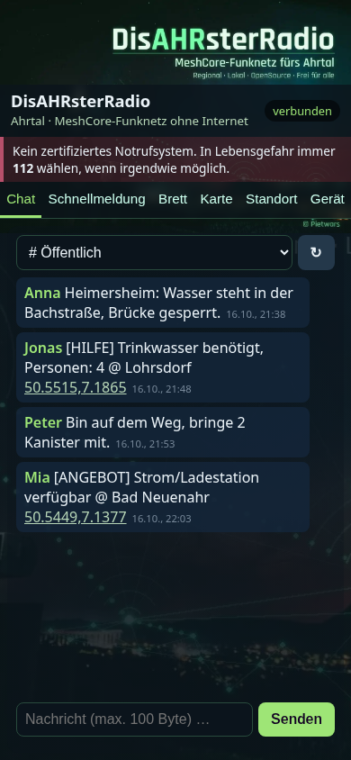
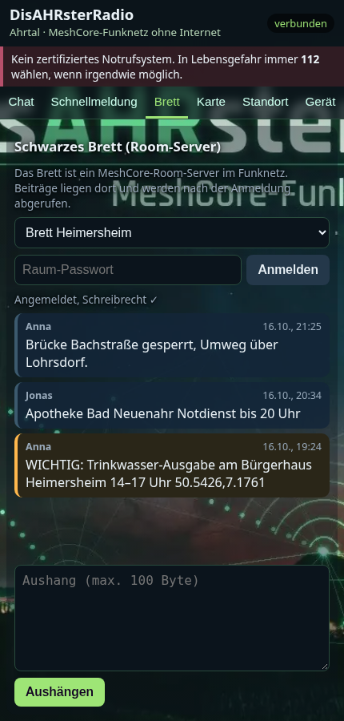
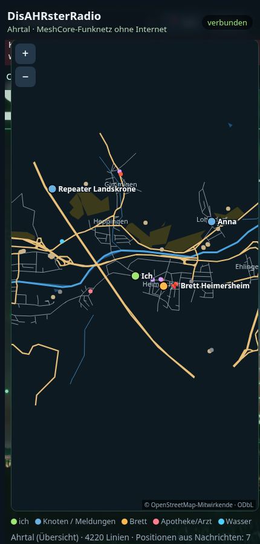

# DisAHRsterRadio-MeshCore

**Version 0.9.0-alpha** · MeshCore 1.18.0 (Upstream `main`, Commit `81dbae59`) · Firmwarekennung `v1.18.0-dar0.9.0-alpha`

**Die DisAHRsterRadio-Weboberfläche fürs Ahrtal auf MeshCore-Firmware.** Das Board ist ein MeshCore-Companion und spannt ein eigenes WLAN auf. Man verbindet sich mit dem Handy und nutzt im Browser Chat, Schnellmeldungen, Brett, Karte und Standort. Eine App ist nicht nötig, Internet auch nicht.

> ⚠️ **Kein zertifiziertes Notrufsystem.** In Lebensgefahr immer **112** wählen, wenn irgendwie möglich.

Verwandte Repositorys:

| Repository | Inhalt |
|---|---|
| [Pietwars/DisasterMesh](https://github.com/Pietwars/DisasterMesh) | Hauptprojekt: MeshCore-Firmware mit der großen MeshAhrtal-Oberfläche, Karten-Download, Werkzeuge, Doku (ebenfalls 0.9.0-alpha / MeshCore 1.18.0) |
| [Pietwars/DisAHRsterRadio-MeshCore](https://github.com/Pietwars/DisAHRsterRadio-MeshCore) (dieses) | Aktuelles MeshCore mit der kompakten DisAHRsterRadio-Oberfläche (Karten, Brett, Standort eingebettet) |
| [Pietwars/DisAHRsterRadio](https://github.com/Pietwars/DisAHRsterRadio) | Ohne MeshCore: modernisiertes disaster-radio (RadioLib, LoRaLayer2) mit derselben Oberfläche, nicht kompatibel zu MeshCore-Knoten |

  

## Ehrlicher Stand (Oktober 2026)

| Punkt | Stand |
|---|---|
| Basis | MeshCore `main` nach **v1.18.0** (meshcore-dev/MeshCore), Git-Historie erhalten |
| Firmware baut | ✅ 3 WLAN-Portale + 4 Repeater/Room-Server, lokal und per GitHub Actions |
| Auf echter Hardware getestet | ❌ **diese Firmware noch nicht.** LILYGO T3 V1.6.1 lief beim Nutzer mit der Schwester-Firmware DisAHRsterRadio vollständig; Heltec V2 zeigte dort ein Strom-/Brownout-Problem (WLAN-AP fehlte), Gegenmaßnahme hier enthalten, ungeprüft |
| Kompatibel mit anderen MeshCore-Geräten/Apps | ✅ normales MeshCore-Funkprotokoll (gleiches Funkprofil vorausgesetzt) |

## Boards

| PlatformIO-Env | Board | Flash belegt |
|---|---|---|
| `disaster_t3s3_sx1262_wifi` | LILYGO T3-S3 SX1262 | ca. 73 % |
| `disaster_tlora_v2_1_sx1276_wifi` | LILYGO T3 V1.6.1 SX1276 | ca. 95 % (knapp) |
| `disaster_heltec_v2_sx1276_wifi` | Heltec WiFi LoRa 32 V2 SX1276 | ca. 77 % |
| `disaster_t3s3_sx1262_repeater` / `_room` | T3-S3 SX1262 als Repeater / Room-Server (Brett) | ca. 29 % |
| `disaster_ttgo_repeater` / `_room` | T3 V1.6.1 / TTGO LoRa32 als Repeater / Room-Server | ca. 44 % |

Weitere Profile (T3-S3 SX1276, SD-Archiv, Heltec-Diagnose) sind in `platformio.local.ini` enthalten, aber nicht im CI.

Heltec V2 mit WLAN-Fix: Brownout-Detektor früh aus, Startmarken `[DIAG …]` seriell, WLAN startet zuletzt und erst 2 s nach dem Funkmodul, WLAN-Sendeleistung 8,5 dBm.

Alle Boards: WLAN **`DisAHRsterRadio-XXXXXX`** mit geräteindividuellem Zufallspasswort, gespeichert im NVS. Das Passwort steht beim Start und danach alle 30 s seriell (115200 Baud) und erscheint abwechselnd mit dem WLAN-Namen auf dem OLED. Startet der Zugangspunkt nicht, versucht es das Gerät alle 5 s erneut.

## So wird die Oberfläche auf MeshCore abgebildet

| Reiter | MeshCore |
|---|---|
| **Chat** | Öffentlicher Kanal, weitere Kanäle (Slots 0–7) und Direktnachrichten an bekannte Chat-Kontakte |
| **Schnellmeldung** | Vorlagen (Trinkwasser, Strom, Medikamente …) mit Ort, gesendet an Kanal oder Kontakt |
| **Brett** | MeshCore-**Room-Server**: anmelden mit Raum-Passwort, Beiträge lesen und schreiben |
| **Karte** | Offline-OSM-Karten (Ahrtal, Heimersheim, Dernau, Altenahr, Sinzig) aus der Firmware. Angezeigt werden Knoten mit Standort in ihrer Bekanntgabe (Advert), Positionen aus Nachrichten und die eigene Position |
| **Standort** | GPS des Handys oder Ortsliste. „Position in Chat senden“ (Format `!DP1\|lat,lon\|zeit`, kompatibel zu DisasterMesh) oder als Knoten-Standort setzen und per Advert bekanntgeben |
| **Gerät** | Status, Funkzähler, Kontakte neu lesen, Advert senden; Admin: Knotenname, Kanal mit Schlüssel |

Nachrichten sind bei MeshCore auf **100 Byte** begrenzt.

## Bauen und Flashen

```bash
pip install platformio
python tools/embed_web.py                       # nach Änderungen an web/
pio run -e disaster_t3s3_sx1262_wifi -t upload
pio run -e disaster_t3s3_sx1262_wifi -t uploadfs  # nur einmal! (Dateisystem, löscht Identität)
tools/package.sh                                 # Flashpakete DisAHRsterRadio-MeshCore-0.9.0-alpha-<board>.zip
```

Die Weboberfläche liegt in `web/index.html`. `tools/embed_web.py` bettet Seite, Hintergrundbild (WebP, 38 KB) und Karten (gzip, 290 KB) in `examples/companion_radio/PortalPage.h` und `PortalAssets.h` ein. Demo ohne Gerät: `web/index.html?demo=1` lokal öffnen.

## Grenzen / offen

- Nicht auf Hardware getestet, auch nicht das Zusammenspiel mit MeshCore 1.18
- T3 V1.6.1 hat nur noch wenig Flash frei (ca. 5 %)
- Die Brett-Funktion braucht einen erreichbaren Room-Server (`disaster_t3s3_sx1262_room` bzw. `disaster_ttgo_room`, im CI gebaut, nicht auf Hardware geprüft)
- Positionsfreigabe: Wer einen Standort als Knoten-Standort setzt, schaltet das Teilen der Position in Adverts ein (bei 0,0 wieder aus)
- Funkprofil-Auswahl (Deutschland-Presets) aus DisasterMesh ist in der neuen Oberfläche nicht enthalten. Die API `/api/radio` existiert weiter
- Karten haben keine Navigation; Datenstand 16.10.2026

## Lizenz und Danksagung

- **MeshCore** © Scott Powell / rippleradios.com und Mitwirkende, **MIT-Lizenz** (`license.txt`). Original-README: [README.meshcore.md](README.meshcore.md).
- WLAN-Portal, Zustell-Warteschlange, Room-/Repeater-Anpassungen: aus [DisasterMesh](https://github.com/Pietwars/DisasterMesh) (MIT).
- Weboberfläche: aus [DisAHRsterRadio](https://github.com/Pietwars/DisAHRsterRadio), vom selben Autor, hier unter MIT.
- Kartendaten © OpenStreetMap-Mitwirkende, ODbL 1.0 (`web/map/ODbL-1.0.txt`).
