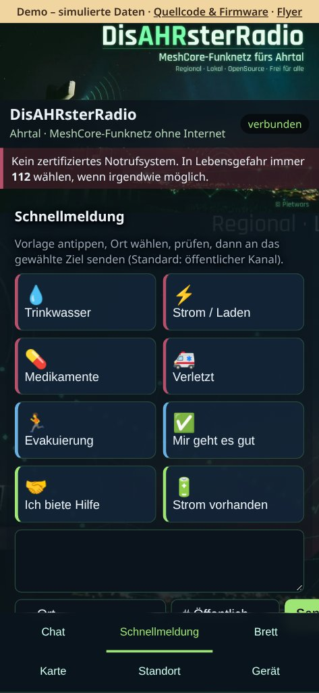
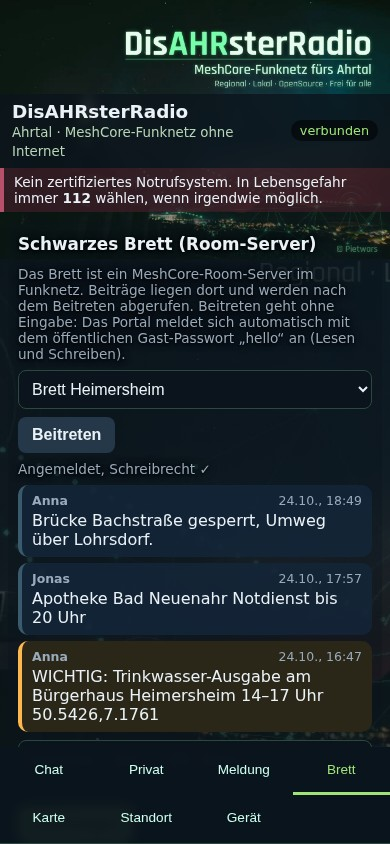
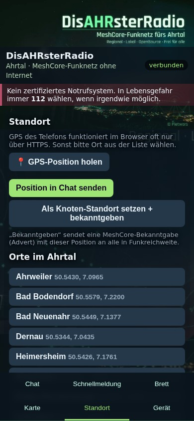
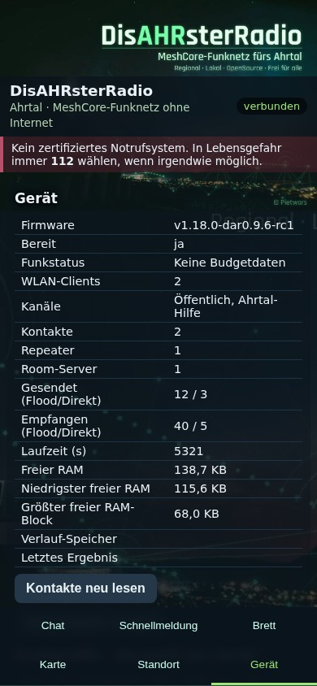

# DisAHRsterRadio-MeshCore

**🔴 Live-Demo (simulierte Daten, kein Gerät nötig): https://pietwars.github.io/DisAHRsterRadio-MeshCore/**

**Version 0.9.0-alpha** · MeshCore 1.18.0 (Upstream `main`, Commit `81dbae59`) · Firmwarekennung `v1.18.0-dar0.9.0-alpha`

**DisAHRsterRadio mit der Weboberfläche MeshAhrtal auf MeshCore-Firmware.** Das Board ist ein MeshCore-Companion und spannt ein eigenes WLAN auf. Man verbindet sich mit dem Handy und nutzt im Browser Chat, Schnellmeldungen, Brett, Karte und Standort. Eine App ist nicht nötig, Internet auch nicht.

> ⚠️ **Kein zertifiziertes Notrufsystem.** In Lebensgefahr immer **112** wählen, wenn irgendwie möglich.

<!-- projektfamilie:start (in allen fünf Repositorys identisch; erzeugt mit DisasterMesh/tools/projektfamilie.py) -->
### Projektfamilie DisAHRsterRadio / HaldenFunk

| Repository | Inhalt | Funk | Version | Demo · Download · Flyer |
|---|---|---|---|---|
| [Pietwars/DisasterMesh](https://github.com/Pietwars/DisasterMesh) | Original-Repo: MeshCore 1.18 mit der großen Weboberfläche MeshAhrtal, Karten, Werkzeuge, Doku (Ahrtal) | MeshCore | 0.9.0-alpha | [Live-Demo](https://pietwars.github.io/DisasterMesh/demo/) · Firmware über [Actions](https://github.com/Pietwars/DisasterMesh/actions) · Flyer [Druck](https://pietwars.github.io/DisasterMesh/flyer/DisasterMesh-Flyer.pdf) / [digital](https://pietwars.github.io/DisasterMesh/flyer/DisasterMesh-Flyer-digital.pdf) |
| [Pietwars/DisAHRsterRadio-MeshCore](https://github.com/Pietwars/DisAHRsterRadio-MeshCore) | MeshCore 1.18 mit kompakter MeshAhrtal-Oberfläche per WLAN plus Bluetooth für die MeshCore-App, 105 Geräte (Ahrtal) | MeshCore | 0.9.0-alpha | [Live-Demo](https://pietwars.github.io/DisAHRsterRadio-MeshCore/) · [Release v0.9.0-alpha](https://github.com/Pietwars/DisAHRsterRadio-MeshCore/releases/tag/v0.9.0-alpha) · Flyer [Druck](https://pietwars.github.io/DisAHRsterRadio-MeshCore/flyer/DisAHRsterRadio-MeshCore-Flyer.pdf) / [digital](https://pietwars.github.io/DisAHRsterRadio-MeshCore/flyer/DisAHRsterRadio-MeshCore-Flyer-digital.pdf) |
| [Pietwars/DisAHRsterRadio](https://github.com/Pietwars/DisAHRsterRadio) | Ohne MeshCore: modernisiertes disaster-radio (LoRaLayer2, RadioLib) mit kompakter MeshAhrtal-Oberfläche (Ahrtal) | LoRaLayer2 | 0.1.1-dev | [Live-Demo](https://pietwars.github.io/DisAHRsterRadio/) · Firmware über [Actions](https://github.com/Pietwars/DisAHRsterRadio/actions) · Flyer [Druck](https://pietwars.github.io/DisAHRsterRadio/flyer/DisAHRsterRadio-Flyer.pdf) / [digital](https://pietwars.github.io/DisAHRsterRadio/flyer/DisAHRsterRadio-Flyer-digital.pdf) |
| [Pietwars/HaldenFunk](https://github.com/Pietwars/HaldenFunk) | Regionalvariante von DisAHRsterRadio für Sangerhausen / Mansfelder Land, ohne MeshCore | LoRaLayer2 | 0.1.1-alpha | [Live-Demo](https://pietwars.github.io/HaldenFunk/) · [Release v0.1.1-alpha](https://github.com/Pietwars/HaldenFunk/releases/tag/v0.1.1-alpha) · Flyer [Druck](https://pietwars.github.io/HaldenFunk/flyer/HaldenFunk-Flyer.pdf) / [digital](https://pietwars.github.io/HaldenFunk/flyer/HaldenFunk-Flyer-digital.pdf) |
| [Pietwars/HaldenFunk-MeshCore](https://github.com/Pietwars/HaldenFunk-MeshCore) | Regionalvariante von DisAHRsterRadio-MeshCore für das Mansfelder Land: MeshCore 1.18, WLAN + Bluetooth, Gerätematrix | MeshCore | 0.1.0-alpha | [Live-Demo](https://pietwars.github.io/HaldenFunk-MeshCore/) · [Release v0.1.0-alpha](https://github.com/Pietwars/HaldenFunk-MeshCore/releases/tag/v0.1.0-alpha) · Flyer [Druck](https://pietwars.github.io/HaldenFunk-MeshCore/flyer/HaldenFunk-MeshCore-Flyer.pdf) / [digital](https://pietwars.github.io/HaldenFunk-MeshCore/flyer/HaldenFunk-MeshCore-Flyer-digital.pdf) |

Gleiche Spalte **Funk** = Geräte können miteinander funken (gleiches Funkprofil vorausgesetzt). MeshCore- und LoRaLayer2-Varianten verstehen sich **nicht**.

**Namen:** **DisAHRsterRadio** = Projekt und Marke (WLAN `DisAHRsterRadio-XXXXXX`) · **MeshAhrtal** = die Weboberfläche im Handy-Browser · **DisasterMesh** = das Original-Repository · **HaldenFunk** = Regionalvariante fürs Mansfelder Land (WLAN `HaldenFunk-XXXXXX`).

Haupt-Boards: LILYGO T3-S3 V1.3, LILYGO T3 V1.6.1 (TTGO), Heltec WiFi LoRa 32 V2 – alle 868 MHz; Hardware-Abnahme steht aus (bisher lief nur LILYGO T3 V1.6.1 mit DisAHRsterRadio beim Nutzer). Druck-Flyer haben QR-Codes, digitale Flyer klickbare Links. Alle Demos sind simuliert.

> ⚠️ Prototyp, kein zertifiziertes Notrufsystem. **Im Notfall immer 112.**
<!-- projektfamilie:end -->

**Download:** [Release v0.9.0-alpha](https://github.com/Pietwars/DisAHRsterRadio-MeshCore/releases/tag/v0.9.0-alpha) (Vorabversion, ein Paket pro Gerät) · **Flyer (A5):** [Druck-PDF mit QR-Codes](docs/flyer/DisAHRsterRadio-MeshCore-Flyer.pdf) · [Digital-PDF mit klickbaren Links](docs/flyer/DisAHRsterRadio-MeshCore-Flyer-digital.pdf)

## Funktionen im Überblick

| Chat | Schnellmeldung | Brett |
|---|---|---|
|  |  |  |
| **Karte** | **Standort** | **Gerät** |
|  |  |  |

(Aufnahmen der [Live-Demo](https://pietwars.github.io/DisAHRsterRadio-MeshCore/) in Handygröße, Stand 0.9.0-alpha; alle Daten simuliert.)

- **Chat:** öffentlicher Kanal, eigene Kanäle und Direktnachrichten, Verlauf auf dem Board
- **Schnellmeldung:** Vorlagen wie Trinkwasser, Strom, Medikamente, Verletzt, Evakuierung mit Ortsangabe
- **Brett:** Schwarzes Brett über einen MeshCore-Room-Server
- **Karte:** Offline-Karten des Ahrtals direkt aus der Firmware, Knoten und geteilte Positionen
- **Standort:** Handy-GPS oder Ortsliste, als Chat-Position oder Knoten-Standort (Advert)
- **Gerät:** Status, Funkzähler, Kontakte, Bekanntgabe, Admin (Name, Kanäle)
- **WLAN + Bluetooth gleichzeitig:** Auf ESP32-Geräten läuft das WLAN-Portal und parallel die Bluetooth-Verbindung für die offizielle MeshCore-App (siehe unten)

## Ehrlicher Stand (Oktober 2026)

| Punkt | Stand |
|---|---|
| Basis | MeshCore `main` nach **v1.18.0** (meshcore-dev/MeshCore), Git-Historie erhalten |
| Firmware baut | ✅ 105 Geräte (202 Builds, 36 Geräte mit WLAN-Portal) per GitHub Actions, veröffentlicht als [Release v0.9.0-alpha](https://github.com/Pietwars/DisAHRsterRadio-MeshCore/releases/tag/v0.9.0-alpha) |
| Auf echter Hardware getestet | ❌ **diese Firmware noch nicht.** LILYGO T3 V1.6.1 lief beim Nutzer mit der Schwester-Firmware DisAHRsterRadio vollständig; Heltec V2 zeigte dort ein Strom-/Brownout-Problem (WLAN-AP fehlte), Gegenmaßnahme hier enthalten, ungeprüft |
| Kompatibel mit anderen MeshCore-Geräten/Apps | ✅ normales MeshCore-Funkprotokoll (gleiches Funkprofil vorausgesetzt) |

## Kartenbedienung und Speicheroptimierung

Die Navigation bleibt unten in zwei Reihen erreichbar (einschließlich iPhone-Safe-Area).
Die Kartenzeichenfläche ist auf ihren Container begrenzt; Zoomtasten sind 44 × 44 Pixel groß.
Im Browser werden maximal zwei Karten zwischengespeichert. Beim schnellen Wechsel gewinnt
immer die zuletzt gewählte Karte. Gleichzeitige Statusabfragen werden vermieden.

Die Weboberfläche wird beim Bauen gzip-komprimiert und direkt aus PROGMEM ausgeliefert.
Die genauen Roh- und gzip-Größen zeigt `python tools/embed_web.py` an (derzeit rund 19,6 kB
Ersparnis gegenüber derselben unkomprimierten Seite). `/api/state` überträgt Kontakte und
Kanäle stückweise, statt dafür einen großen Gesamt-String im Geräte-RAM anzulegen.
Unter „Gerät“ erscheinen freier RAM, bisheriges RAM-Minimum und größter freier Block.
Karten, Bluetooth, Kontaktlimit und Nachrichtenwarteschlange bleiben erhalten.
Die fünf Ahrtal-Karten sind mit `tools/shrink_maps.py` vereinfacht (zusammen ca. 190 KB gzip statt 290 KB; Orte und POIs vollständig). Neu erzeugen: `python3 tools/make_map.py <DisasterMesh/maps> /tmp/roh && python3 tools/shrink_maps.py /tmp/roh web/map && python3 tools/embed_web.py`.

Regressionstest: `node tests/web_regression.cjs` (Node 22); prüft JavaScript-Syntax,
gzip-Roundtrip, CSS-Selektoren, Kartencache und überholte Ladeantworten. Dies ersetzt
keinen Safari-/Hardwaretest. Vor Freigabe auf iPhone Hoch-/Querformat, Tastatur,
Karte → Chat/Brett und auf dem Board mehrere WLAN-Clients sowie BLE parallel prüfen.

## Boards

| PlatformIO-Env | Board | App-Partition belegt (3 MB, `huge_app.csv`) |
|---|---|---|
| `disaster_t3s3_sx1262_wifi` | LILYGO T3-S3 SX1262 | ca. 65 % |
| `disaster_tlora_v2_1_sx1276_wifi` | LILYGO T3 V1.6.1 SX1276 | ca. 72 % (vorher 87 %: -O0 und Sensorbibliotheken, siehe CHANGELOG) |
| `disaster_heltec_v2_sx1276_wifi` | Heltec WiFi LoRa 32 V2 SX1276 | ca. 72 % |
| `disaster_t3s3_sx1262_repeater` / `_room` | T3-S3 SX1262 als Repeater / Room-Server (Brett) | ca. 29 % |
| `disaster_ttgo_repeater` / `_room` | T3 V1.6.1 / TTGO LoRa32 als Repeater / Room-Server | ca. 30 % (vorher 44 %) |

Weitere Profile (T3-S3 SX1276, SD-Archiv, Heltec-Diagnose) sind in `platformio.local.ini` enthalten, aber nicht im CI.

Heltec V2 mit WLAN-Fix: Brownout-Detektor früh aus, Startmarken `[DIAG …]` seriell, WLAN startet zuletzt und erst 2 s nach dem Funkmodul, WLAN-Sendeleistung 8,5 dBm.

Alle Boards: WLAN **`DisAHRsterRadio-XXXXXX`** mit geräteindividuellem Zufallspasswort, gespeichert im NVS. Das Passwort steht beim Start und danach alle 30 s seriell (115200 Baud) und erscheint abwechselnd mit dem WLAN-Namen auf dem OLED. Startet der Zugangspunkt nicht, versucht es das Gerät alle 5 s erneut.

## WLAN-Portal und MeshCore-App gleichzeitig (Bluetooth)

Auf ESP32-Geräten mit Bluetooth sind Web-Portal und BLE-Companion beide am selben Companion angemeldet (MeshCore `MultiSerialInterface`): Jede Antwort und jede eingehende Nachricht geht an beide. Die offizielle MeshCore-App verbindet sich per Bluetooth, während Handys im WLAN die Weboberfläche nutzen.

- **Bluetooth-PIN:** pro Gerät zufällig (6-stellig), beim ersten Start erzeugt und gespeichert. Steht seriell (115200 Baud, Zeile `[BLE] MeshCore-App: Bluetooth-PIN …`, alle 30 s wiederholt) und auf dem Display.
- **Grenzen:** Ruft die App Nachrichten aus der Warteschlange ab, sieht das Portal sie im Verlauf mit, die App aber nicht umgekehrt die Abrufe des Portals. Gleichzeitige Befehle aus App und Portal können sich in seltenen Fällen kreuzen. WLAN + Bluetooth + Webserver brauchen viel RAM; auf klassischen ESP32 (T3 V1.6.1, Heltec V2) ist das auf Hardware **nicht geprüft**.
- **Speicher:** Portal-Profile nutzen jetzt die Partition `huge_app.csv` (3 MB App, kein OTA, 896 KB SPIFFS). T3 V1.6.1: 72 % von 3 MB, T3-S3: 65 %, Heltec V2: 72 %. Nach dem Wechsel von 0.1.0/älter einmal komplett mit `factory.bin` flashen (Partitionstabelle ändert sich, Identität wird neu erzeugt).

## So wird die Oberfläche auf MeshCore abgebildet

| Reiter | MeshCore |
|---|---|
| **Chat** | Öffentlicher Kanal, weitere Kanäle (Slots 0–7) und Direktnachrichten an bekannte Chat-Kontakte |
| **Schnellmeldung** | Vorlagen (Trinkwasser, Strom, Medikamente …) mit Ort, gesendet an Kanal oder Kontakt |
| **Brett** | MeshCore-**Room-Server**: anmelden mit Raum-Passwort, Beiträge lesen und schreiben |
| **Karte** | Offline-OSM-Karten (Ahrtal, Heimersheim, Dernau, Altenahr, Sinzig) aus der Firmware. Angezeigt werden Knoten mit Standort in ihrer Bekanntgabe (Advert), Positionen aus Nachrichten und die eigene Position |
| **Standort** | GPS des Handys oder Ortsliste. „Position in Chat senden“ (Format `!DP1\|lat,lon\|zeit`, kompatibel zu DisasterMesh) oder als Knoten-Standort setzen und per Advert bekanntgeben |
| **Gerät** | Status, Funkzähler, Kontakte neu lesen, Advert senden; Admin: Knotenname, Kanal mit Schlüssel |

Nachrichten sind bei MeshCore auf **100 Byte** begrenzt.

## Bauen und Flashen

```bash
pip install platformio
python tools/embed_web.py                       # nach Änderungen an web/
pio run -e disaster_t3s3_sx1262_wifi -t upload
pio run -e disaster_t3s3_sx1262_wifi -t uploadfs  # nur einmal! (Dateisystem, löscht Identität)
tools/package.sh                                 # Flashpakete DisAHRsterRadio-MeshCore-0.9.0-alpha-<board>.zip
```

Die Weboberfläche liegt in `web/index.html`. `tools/embed_web.py` bettet die gzip-komprimierte Seite, Hintergrundbild (WebP, 38 KB) und Karten (gzip, 290 KB) in `examples/companion_radio/PortalPage.h` und `PortalAssets.h` ein. Demo ohne Gerät: `web/index.html?demo=1` lokal öffnen.

## Alle Geräte (MeshCore-Konfigurator-Liste)

Gebaut werden alle 105 Geräte, für die MeshCore v1.18.0 Firmware anbietet (Quelle der Liste im [MeshCore-Konfigurator](https://meshcore.co.uk/configurator/): `flasher.meshcore.io/releases`, gespeichert in `tools/devices.upstream.json`, Envs aus `tools/gen_devices.py` → `platformio.devices.ini`). ESP32-Geräte mit Companion-Firmware bekommen das DisAHRsterRadio-WLAN-Portal (+ Bluetooth), alle anderen die normale MeshCore-Firmware **ohne Web-Oberfläche** (Companion, Repeater, Room-Server; Funkprofil MeshCore-Standard EU 869,618 MHz / 62,5 kHz / SF8). Nur der LILYGO T3 V1.6.1 ist auf Hardware geprüft (mit der Schwester-Firmware).

| Gerät | Chip | Web-Oberfläche | Inhalt | Datei |
|---|---|---|---|---|
| Ebyte_EoRa-S3 | esp32s3 | ja | WLAN-Portal | `DisAHRsterRadio-MeshCore-0.9.0-alpha-Ebyte_EoRa-S3.zip` |
| GAT562_30S_Mesh_Kit | nrf52 | nein (ohne Web-Oberfläche) | Companion, Repeater, Room-Server | `DisAHRsterRadio-MeshCore-0.9.0-alpha-GAT562_30S_Mesh_Kit.zip` |
| GAT562_Mesh_EVB_Pro | nrf52 | nein (ohne Web-Oberfläche) | Repeater, Room-Server | `DisAHRsterRadio-MeshCore-0.9.0-alpha-GAT562_Mesh_EVB_Pro.zip` |
| GAT562_Mesh_Tracker_Pro | nrf52 | nein (ohne Web-Oberfläche) | Companion, Repeater, Room-Server | `DisAHRsterRadio-MeshCore-0.9.0-alpha-GAT562_Mesh_Tracker_Pro.zip` |
| GAT562_Mesh_Watch13 | nrf52 | nein (ohne Web-Oberfläche) | Companion | `DisAHRsterRadio-MeshCore-0.9.0-alpha-GAT562_Mesh_Watch13.zip` |
| Generic_E22_sx1262 | esp32 | nein (ohne Web-Oberfläche) | Repeater | `DisAHRsterRadio-MeshCore-0.9.0-alpha-Generic_E22_sx1262.zip` |
| Generic_E22_sx1268 | esp32 | nein (ohne Web-Oberfläche) | Repeater | `DisAHRsterRadio-MeshCore-0.9.0-alpha-Generic_E22_sx1268.zip` |
| Heltec_ct62 | esp32c3 | ja | WLAN-Portal | `DisAHRsterRadio-MeshCore-0.9.0-alpha-Heltec_ct62.zip` |
| Heltec_E213 | esp32s3 | ja | WLAN-Portal | `DisAHRsterRadio-MeshCore-0.9.0-alpha-Heltec_E213.zip` |
| Heltec_E290 | esp32s3 | nein (ohne Web-Oberfläche) | Repeater, Room-Server | `DisAHRsterRadio-MeshCore-0.9.0-alpha-Heltec_E290.zip` |
| Heltec_mesh_solar | nrf52 | nein (ohne Web-Oberfläche) | Repeater, Room-Server | `DisAHRsterRadio-MeshCore-0.9.0-alpha-Heltec_mesh_solar.zip` |
| heltec_rc32 | esp32s3 | ja | WLAN-Portal | `DisAHRsterRadio-MeshCore-0.9.0-alpha-heltec_rc32.zip` |
| heltec_rc32_without_display | esp32s3 | ja | WLAN-Portal | `DisAHRsterRadio-MeshCore-0.9.0-alpha-heltec_rc32_without_display.zip` |
| Heltec_t096 | nrf52 | nein (ohne Web-Oberfläche) | Companion, Repeater, Room-Server | `DisAHRsterRadio-MeshCore-0.9.0-alpha-Heltec_t096.zip` |
| Heltec_t1 | nrf52 | nein (ohne Web-Oberfläche) | Companion, Repeater, Room-Server | `DisAHRsterRadio-MeshCore-0.9.0-alpha-Heltec_t1.zip` |
| Heltec_t114 | nrf52 | nein (ohne Web-Oberfläche) | Companion, Repeater, Room-Server | `DisAHRsterRadio-MeshCore-0.9.0-alpha-Heltec_t114.zip` |
| Heltec_t114_without_display | nrf52 | nein (ohne Web-Oberfläche) | Companion, Repeater, Room-Server | `DisAHRsterRadio-MeshCore-0.9.0-alpha-Heltec_t114_without_display.zip` |
| Heltec_tower_v2 | nrf52 | nein (ohne Web-Oberfläche) | Companion, Repeater, Room-Server | `DisAHRsterRadio-MeshCore-0.9.0-alpha-Heltec_tower_v2.zip` |
| heltec_tracker_v2 | esp32s3 | ja | WLAN-Portal | `DisAHRsterRadio-MeshCore-0.9.0-alpha-heltec_tracker_v2.zip` |
| Heltec_v2 | esp32 | ja | WLAN-Portal | `DisAHRsterRadio-MeshCore-0.9.0-alpha-Heltec_v2.zip` |
| Heltec_v3 | esp32s3 | ja | WLAN-Portal | `DisAHRsterRadio-MeshCore-0.9.0-alpha-Heltec_v3.zip` |
| heltec_v4 | esp32s3 | ja | WLAN-Portal | `DisAHRsterRadio-MeshCore-0.9.0-alpha-heltec_v4.zip` |
| heltec_v4_expansionkit | esp32s3 | nein (ohne Web-Oberfläche) | Repeater | `DisAHRsterRadio-MeshCore-0.9.0-alpha-heltec_v4_expansionkit.zip` |
| heltec_v4_r8 | esp32s3 | ja | WLAN-Portal | `DisAHRsterRadio-MeshCore-0.9.0-alpha-heltec_v4_r8.zip` |
| heltec_v4_r8_tft | esp32s3 | ja | WLAN-Portal | `DisAHRsterRadio-MeshCore-0.9.0-alpha-heltec_v4_r8_tft.zip` |
| heltec_v4_tft | esp32s3 | ja | WLAN-Portal | `DisAHRsterRadio-MeshCore-0.9.0-alpha-heltec_v4_tft.zip` |
| Heltec_Wireless_Paper | esp32s3 | ja | WLAN-Portal | `DisAHRsterRadio-MeshCore-0.9.0-alpha-Heltec_Wireless_Paper.zip` |
| Heltec_Wireless_Tracker | esp32s3 | ja | WLAN-Portal | `DisAHRsterRadio-MeshCore-0.9.0-alpha-Heltec_Wireless_Tracker.zip` |
| Heltec_WSL3 | esp32s3 | ja | WLAN-Portal | `DisAHRsterRadio-MeshCore-0.9.0-alpha-Heltec_WSL3.zip` |
| ikoka_handheld_nrf_e22_30dbm | nrf52 | nein (ohne Web-Oberfläche) | Repeater, Room-Server | `DisAHRsterRadio-MeshCore-0.9.0-alpha-ikoka_handheld_nrf_e22_30dbm.zip` |
| ikoka_handheld_nrf_e22_30dbm_096 | nrf52 | nein (ohne Web-Oberfläche) | Companion | `DisAHRsterRadio-MeshCore-0.9.0-alpha-ikoka_handheld_nrf_e22_30dbm_096.zip` |
| ikoka_handheld_nrf_e22_30dbm_096_rotated | nrf52 | nein (ohne Web-Oberfläche) | Companion | `DisAHRsterRadio-MeshCore-0.9.0-alpha-ikoka_handheld_nrf_e22_30dbm_096_rotated.zip` |
| ikoka_nano_nrf_22dbm | nrf52 | nein (ohne Web-Oberfläche) | Companion, Repeater, Room-Server | `DisAHRsterRadio-MeshCore-0.9.0-alpha-ikoka_nano_nrf_22dbm.zip` |
| ikoka_nano_nrf_30dbm | nrf52 | nein (ohne Web-Oberfläche) | Companion, Repeater, Room-Server | `DisAHRsterRadio-MeshCore-0.9.0-alpha-ikoka_nano_nrf_30dbm.zip` |
| ikoka_nano_nrf_33dbm | nrf52 | nein (ohne Web-Oberfläche) | Companion, Repeater, Room-Server | `DisAHRsterRadio-MeshCore-0.9.0-alpha-ikoka_nano_nrf_33dbm.zip` |
| ikoka_stick_nrf_22dbm | nrf52 | nein (ohne Web-Oberfläche) | Companion, Repeater, Room-Server | `DisAHRsterRadio-MeshCore-0.9.0-alpha-ikoka_stick_nrf_22dbm.zip` |
| ikoka_stick_nrf_30dbm | nrf52 | nein (ohne Web-Oberfläche) | Companion, Repeater, Room-Server | `DisAHRsterRadio-MeshCore-0.9.0-alpha-ikoka_stick_nrf_30dbm.zip` |
| ikoka_stick_nrf_33dbm | nrf52 | nein (ohne Web-Oberfläche) | Companion, Repeater, Room-Server | `DisAHRsterRadio-MeshCore-0.9.0-alpha-ikoka_stick_nrf_33dbm.zip` |
| KeepteenLT1 | nrf52 | nein (ohne Web-Oberfläche) | Companion, Repeater, Room-Server | `DisAHRsterRadio-MeshCore-0.9.0-alpha-KeepteenLT1.zip` |
| LilyGo_T-Echo | nrf52 | nein (ohne Web-Oberfläche) | Companion, Repeater, Room-Server | `DisAHRsterRadio-MeshCore-0.9.0-alpha-LilyGo_T-Echo.zip` |
| LilyGo_T-Echo-Lite | nrf52 | nein (ohne Web-Oberfläche) | Companion, Repeater, Room-Server | `DisAHRsterRadio-MeshCore-0.9.0-alpha-LilyGo_T-Echo-Lite.zip` |
| LilyGo_T-Echo-Lite_non_shell | nrf52 | nein (ohne Web-Oberfläche) | Companion | `DisAHRsterRadio-MeshCore-0.9.0-alpha-LilyGo_T-Echo-Lite_non_shell.zip` |
| LilyGo_T-Echo_Card | nrf52 | nein (ohne Web-Oberfläche) | Companion, Repeater, Room-Server | `DisAHRsterRadio-MeshCore-0.9.0-alpha-LilyGo_T-Echo_Card.zip` |
| LilyGo_T3S3_sx1262 | esp32s3 | ja | WLAN-Portal | `DisAHRsterRadio-MeshCore-0.9.0-alpha-LilyGo_T3S3_sx1262.zip` |
| LilyGo_T3S3_sx1276 | esp32s3 | ja | WLAN-Portal | `DisAHRsterRadio-MeshCore-0.9.0-alpha-LilyGo_T3S3_sx1276.zip` |
| LilyGo_T_Impulse_Plus | nrf52 | nein (ohne Web-Oberfläche) | Companion, Repeater | `DisAHRsterRadio-MeshCore-0.9.0-alpha-LilyGo_T_Impulse_Plus.zip` |
| LilyGo_TBeam_1W | esp32s3 | ja | WLAN-Portal | `DisAHRsterRadio-MeshCore-0.9.0-alpha-LilyGo_TBeam_1W.zip` |
| LilyGo_TDeck | esp32s3 | ja | WLAN-Portal | `DisAHRsterRadio-MeshCore-0.9.0-alpha-LilyGo_TDeck.zip` |
| LilyGo_TETH_Elite_sx1262 | esp32s3 | ja | WLAN-Portal | `DisAHRsterRadio-MeshCore-0.9.0-alpha-LilyGo_TETH_Elite_sx1262.zip` |
| LilyGo_TLora_V2_1_1_6 | esp32 | ja | WLAN-Portal | `DisAHRsterRadio-MeshCore-0.9.0-alpha-LilyGo_TLora_V2_1_1_6.zip` |
| M5Stack_Unit_C6L | esp32c6 | nein (ohne Web-Oberfläche: ESP32-C6: WLAN-Bibliothek (Network.h) im Portal-Build nicht auflösbar) | Companion, Repeater, Room-Server | `DisAHRsterRadio-MeshCore-0.9.0-alpha-M5Stack_Unit_C6L.zip` |
| Mesh_pocket | nrf52 | nein (ohne Web-Oberfläche) | Companion, Repeater, Room-Server | `DisAHRsterRadio-MeshCore-0.9.0-alpha-Mesh_pocket.zip` |
| Meshadventurer_sx1262 | esp32 | ja | WLAN-Portal | `DisAHRsterRadio-MeshCore-0.9.0-alpha-Meshadventurer_sx1262.zip` |
| Meshadventurer_sx1268 | esp32 | ja | WLAN-Portal | `DisAHRsterRadio-MeshCore-0.9.0-alpha-Meshadventurer_sx1268.zip` |
| meshnology_w12 | esp32s3 | ja | WLAN-Portal | `DisAHRsterRadio-MeshCore-0.9.0-alpha-meshnology_w12.zip` |
| Meshtiny | nrf52 | nein (ohne Web-Oberfläche) | Companion | `DisAHRsterRadio-MeshCore-0.9.0-alpha-Meshtiny.zip` |
| MeshTracker_X1 | nrf52 | nein (ohne Web-Oberfläche) | Companion, Repeater, Room-Server | `DisAHRsterRadio-MeshCore-0.9.0-alpha-MeshTracker_X1.zip` |
| Minewsemi_me25ls01 | nrf52 | nein (ohne Web-Oberfläche) | Companion, Repeater, Room-Server | `DisAHRsterRadio-MeshCore-0.9.0-alpha-Minewsemi_me25ls01.zip` |
| muzi_base_duo | nrf52 | nein (ohne Web-Oberfläche) | Companion, Repeater, Room-Server | `DisAHRsterRadio-MeshCore-0.9.0-alpha-muzi_base_duo.zip` |
| muzi_base_duo_superIO | nrf52 | nein (ohne Web-Oberfläche) | Companion | `DisAHRsterRadio-MeshCore-0.9.0-alpha-muzi_base_duo_superIO.zip` |
| muzi_base_uno | nrf52 | nein (ohne Web-Oberfläche) | Companion, Repeater, Room-Server | `DisAHRsterRadio-MeshCore-0.9.0-alpha-muzi_base_uno.zip` |
| muzi_base_uno_superIO | nrf52 | nein (ohne Web-Oberfläche) | Companion | `DisAHRsterRadio-MeshCore-0.9.0-alpha-muzi_base_uno_superIO.zip` |
| Nano_G2_Ultra | nrf52 | nein (ohne Web-Oberfläche) | Companion, Repeater, Room-Server | `DisAHRsterRadio-MeshCore-0.9.0-alpha-Nano_G2_Ultra.zip` |
| PicoW | rp2040 | nein (ohne Web-Oberfläche) | Companion, Repeater, Room-Server | `DisAHRsterRadio-MeshCore-0.9.0-alpha-PicoW.zip` |
| ProMicro | nrf52 | nein (ohne Web-Oberfläche) | Companion, Repeater, Room-Server | `DisAHRsterRadio-MeshCore-0.9.0-alpha-ProMicro.zip` |
| R1Neo | nrf52 | nein (ohne Web-Oberfläche) | Companion, Repeater, Room-Server | `DisAHRsterRadio-MeshCore-0.9.0-alpha-R1Neo.zip` |
| RAK_11310 | rp2040 | nein (ohne Web-Oberfläche) | Companion, Repeater, Room-Server | `DisAHRsterRadio-MeshCore-0.9.0-alpha-RAK_11310.zip` |
| RAK_3112 | esp32s3 | ja | WLAN-Portal | `DisAHRsterRadio-MeshCore-0.9.0-alpha-RAK_3112.zip` |
| RAK_3401 | nrf52 | nein (ohne Web-Oberfläche) | Companion, Repeater, Room-Server | `DisAHRsterRadio-MeshCore-0.9.0-alpha-RAK_3401.zip` |
| RAK_3x72 | stm32 | nein (ohne Web-Oberfläche) | Companion, Repeater | `DisAHRsterRadio-MeshCore-0.9.0-alpha-RAK_3x72.zip` |
| RAK_4631 | nrf52 | nein (ohne Web-Oberfläche) | Companion, Repeater, Room-Server | `DisAHRsterRadio-MeshCore-0.9.0-alpha-RAK_4631.zip` |
| RAK_WisMesh_Tag | nrf52 | nein (ohne Web-Oberfläche) | Companion, Repeater, Room-Server | `DisAHRsterRadio-MeshCore-0.9.0-alpha-RAK_WisMesh_Tag.zip` |
| SenseCap_Solar | nrf52 | nein (ohne Web-Oberfläche) | Companion, Repeater, Room-Server | `DisAHRsterRadio-MeshCore-0.9.0-alpha-SenseCap_Solar.zip` |
| Station_G2 | esp32s3 | ja | WLAN-Portal | `DisAHRsterRadio-MeshCore-0.9.0-alpha-Station_G2.zip` |
| Station_G2_logging | esp32s3 | nein (ohne Web-Oberfläche) | Repeater | `DisAHRsterRadio-MeshCore-0.9.0-alpha-Station_G2_logging.zip` |
| Station_G3_ESP32 | esp32s3 | ja | WLAN-Portal | `DisAHRsterRadio-MeshCore-0.9.0-alpha-Station_G3_ESP32.zip` |
| Station_G3_ESP32_logging | esp32s3 | nein (ohne Web-Oberfläche) | Repeater | `DisAHRsterRadio-MeshCore-0.9.0-alpha-Station_G3_ESP32_logging.zip` |
| t1000e | nrf52 | nein (ohne Web-Oberfläche) | Companion, Repeater, Room-Server | `DisAHRsterRadio-MeshCore-0.9.0-alpha-t1000e.zip` |
| T_Beam_S3_Supreme_SX1262 | esp32s3 | ja | WLAN-Portal | `DisAHRsterRadio-MeshCore-0.9.0-alpha-T_Beam_S3_Supreme_SX1262.zip` |
| Tbeam_SX1262 | esp32 | ja | WLAN-Portal | `DisAHRsterRadio-MeshCore-0.9.0-alpha-Tbeam_SX1262.zip` |
| Tbeam_SX1276 | esp32 | ja | WLAN-Portal | `DisAHRsterRadio-MeshCore-0.9.0-alpha-Tbeam_SX1276.zip` |
| Tenstar_C3_sx1262 | esp32c3 | nein (ohne Web-Oberfläche) | Repeater | `DisAHRsterRadio-MeshCore-0.9.0-alpha-Tenstar_C3_sx1262.zip` |
| Tenstar_C3_sx1268 | esp32c3 | nein (ohne Web-Oberfläche) | Repeater | `DisAHRsterRadio-MeshCore-0.9.0-alpha-Tenstar_C3_sx1268.zip` |
| ThinkNode_M1 | nrf52 | nein (ohne Web-Oberfläche) | Companion, Repeater, Room-Server | `DisAHRsterRadio-MeshCore-0.9.0-alpha-ThinkNode_M1.zip` |
| ThinkNode_M2 | esp32s3 | ja | WLAN-Portal | `DisAHRsterRadio-MeshCore-0.9.0-alpha-ThinkNode_M2.zip` |
| ThinkNode_M3 | nrf52 | nein (ohne Web-Oberfläche) | Companion, Repeater, Room-Server | `DisAHRsterRadio-MeshCore-0.9.0-alpha-ThinkNode_M3.zip` |
| ThinkNode_M4 | nrf52 | nein (ohne Web-Oberfläche) | Companion, Repeater, Room-Server | `DisAHRsterRadio-MeshCore-0.9.0-alpha-ThinkNode_M4.zip` |
| ThinkNode_M5 | esp32s3 | ja | WLAN-Portal | `DisAHRsterRadio-MeshCore-0.9.0-alpha-ThinkNode_M5.zip` |
| ThinkNode_M6 | nrf52 | nein (ohne Web-Oberfläche) | Companion, Repeater, Room-Server | `DisAHRsterRadio-MeshCore-0.9.0-alpha-ThinkNode_M6.zip` |
| ThinkNode_M7 | esp32s3 | nein (ohne Web-Oberfläche: eigene Display-Oberfläche ohne Hinweisfunktion (showAlert) – Portal baut nicht) | Companion, Repeater, Room-Server | `DisAHRsterRadio-MeshCore-0.9.0-alpha-ThinkNode_M7.zip` |
| ThinkNode_M8 | nrf52 | nein (ohne Web-Oberfläche: Repeater/Room-Server: Upstream-Linkfehler (EnvironmentSensorManager fehlt im Build)) | Companion | `DisAHRsterRadio-MeshCore-0.9.0-alpha-ThinkNode_M8.zip` |
| Tiny_Relay | stm32 | nein (ohne Web-Oberfläche) | Companion, Repeater | `DisAHRsterRadio-MeshCore-0.9.0-alpha-Tiny_Relay.zip` |
| waveshare_rp2040_lora | rp2040 | nein (ohne Web-Oberfläche) | Companion, Repeater, Room-Server | `DisAHRsterRadio-MeshCore-0.9.0-alpha-waveshare_rp2040_lora.zip` |
| Waveshare_S3_LR1121 | esp32s3 | ja | WLAN-Portal | `DisAHRsterRadio-MeshCore-0.9.0-alpha-Waveshare_S3_LR1121.zip` |
| wio-e5 | stm32 | nein (ohne Web-Oberfläche) | Companion, Repeater | `DisAHRsterRadio-MeshCore-0.9.0-alpha-wio-e5.zip` |
| wio-e5-mini | stm32 | nein (ohne Web-Oberfläche) | Companion, Repeater | `DisAHRsterRadio-MeshCore-0.9.0-alpha-wio-e5-mini.zip` |
| wio_wm1110 | nrf52 | nein (ohne Web-Oberfläche) | Companion, Repeater, Room-Server | `DisAHRsterRadio-MeshCore-0.9.0-alpha-wio_wm1110.zip` |
| WioTrackerL1 | nrf52 | nein (ohne Web-Oberfläche) | Companion, Repeater, Room-Server | `DisAHRsterRadio-MeshCore-0.9.0-alpha-WioTrackerL1.zip` |
| WioTrackerL1-1W | nrf52 | nein (ohne Web-Oberfläche) | Companion, Repeater, Room-Server | `DisAHRsterRadio-MeshCore-0.9.0-alpha-WioTrackerL1-1W.zip` |
| WioTrackerL1Eink | nrf52 | nein (ohne Web-Oberfläche) | Companion | `DisAHRsterRadio-MeshCore-0.9.0-alpha-WioTrackerL1Eink.zip` |
| Xiao_C3 | esp32c3 | ja | WLAN-Portal | `DisAHRsterRadio-MeshCore-0.9.0-alpha-Xiao_C3.zip` |
| Xiao_nrf52 | nrf52 | nein (ohne Web-Oberfläche) | Companion, Repeater, Room-Server | `DisAHRsterRadio-MeshCore-0.9.0-alpha-Xiao_nrf52.zip` |
| Xiao_rp2040 | rp2040 | nein (ohne Web-Oberfläche) | Companion, Repeater, Room-Server | `DisAHRsterRadio-MeshCore-0.9.0-alpha-Xiao_rp2040.zip` |
| Xiao_S3 | esp32s3 | ja | WLAN-Portal | `DisAHRsterRadio-MeshCore-0.9.0-alpha-Xiao_S3.zip` |
| Xiao_S3_WIO | esp32s3 | ja | WLAN-Portal | `DisAHRsterRadio-MeshCore-0.9.0-alpha-Xiao_S3_WIO.zip` |

## Grenzen / offen

- Nicht auf Hardware getestet, auch nicht das Zusammenspiel mit MeshCore 1.18
- T3 V1.6.1 hat nur noch wenig Flash frei (ca. 5 %)
- Die Brett-Funktion braucht einen erreichbaren Room-Server (`disaster_t3s3_sx1262_room` bzw. `disaster_ttgo_room`, im CI gebaut, nicht auf Hardware geprüft)
- Positionsfreigabe: Wer einen Standort als Knoten-Standort setzt, schaltet das Teilen der Position in Adverts ein (bei 0,0 wieder aus)
- Funkprofil-Auswahl (Deutschland-Presets) aus DisasterMesh ist in der neuen Oberfläche nicht enthalten. Die API `/api/radio` existiert weiter
- Karten haben keine Navigation; Datenstand 16.10.2026

## Lizenz und Danksagung

- **MeshCore** © Scott Powell / rippleradios.com und Mitwirkende, **MIT-Lizenz** (`license.txt`). Original-README: [README.meshcore.md](README.meshcore.md).
- WLAN-Portal, Zustell-Warteschlange, Room-/Repeater-Anpassungen: aus [DisasterMesh](https://github.com/Pietwars/DisasterMesh) (MIT).
- Weboberfläche: aus [DisAHRsterRadio](https://github.com/Pietwars/DisAHRsterRadio), vom selben Autor, hier unter MIT.
- Kartendaten © OpenStreetMap-Mitwirkende, ODbL 1.0 (`web/map/ODbL-1.0.txt`).
