# Standalone 0.9.6-rc1: aktuelle Vorschauen

Echte Firmware-Layouts mit Demodaten. Hardwareabnahme dieser Version offen. [Bedienung](STANDALONE_TOUCH.md) · [Release-Status](RELEASE-0.9.6.md)

## Bootmotiv

## Bretter / Room-Server

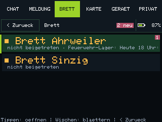

## Brett: Beitreten und Aushang

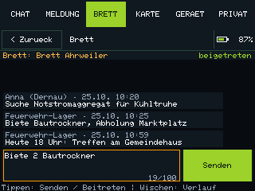

## Direktnachrichten

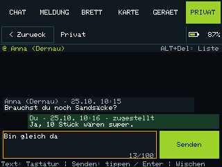

## Chat: Kanaele und Kontakte

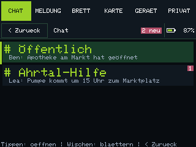

## Chat mit Senden-Button

## Weitere Geraeteaktionen

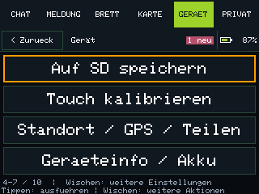

## Geraeteaktionen

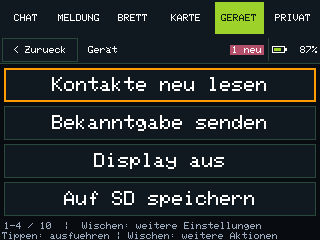

## Geraeteinfo und Akku

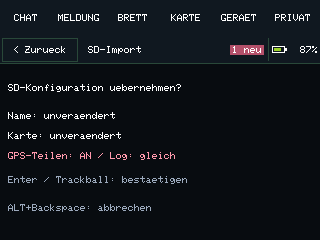

## Hauptmenue

## Karte: Detail

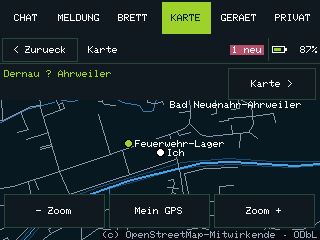

## Offlinekarte

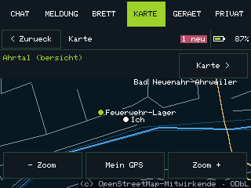

## Schnellmeldung

## Ort waehlen

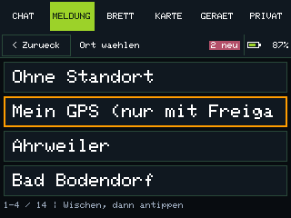

## GPS und Standortfreigabe

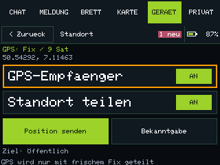

## Vorlagen: weiterblaettern

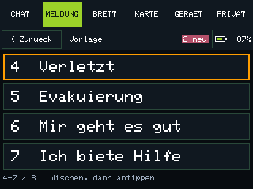

## Vorlagen waehlen

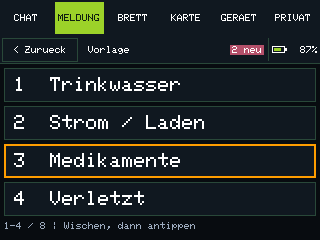

## Empfaenger waehlen

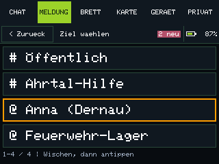

## Privat: gespeicherte Kontakte

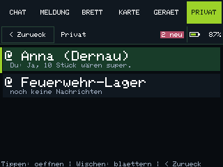
